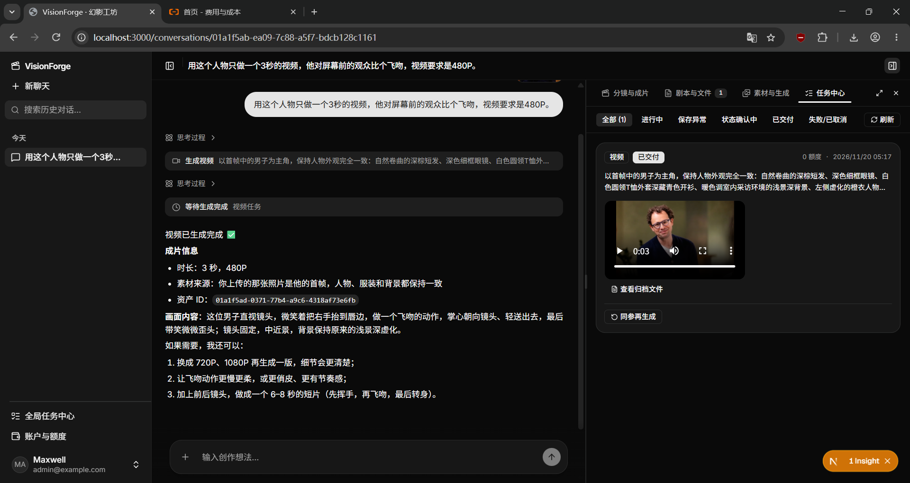

# VisionForge

**One sentence is all it takes: let AI write the script, build the storyboard, design the characters, and shoot the shots — then deliver a high-quality short film.**

[简体中文](README_zh-CN.md) · [Documentation](docs/README.md) · [Contributing](CONTRIBUTING.md)


---

## Demo



The agent reads the reference portrait, generates a 3-second 480P clip, and returns the delivered video in the conversation's task center:

<video src="https://cdn.jsdelivr.net/gh/AspirinMX/VisionForge@main/assets/demo.mp4" controls muted width="100%"></video>

If the inline player is unavailable, [open the generated video](assets/demo.mp4).

---

## What it can do

- 🎬 **From one sentence to a final cut** — describe a short film, an ad, or a shot; VisionForge takes it through script, storyboard, first frame, shot video, and composition.
- 🧠 **A director with memory** — a multi-turn, tool-using agent that remembers characters, continuity, and earlier decisions instead of restarting from scratch.
- 🎞️ **A storyboard you can actually edit** — validated JSON storyboards, shot-level first-frame and video candidates, and a live canvas beside the conversation.
- 🖼️ **The models you actually want** — OpenAI Responses/Images, Volcengine Ark Seedream & Seedance, Alibaba Bailian Wanxiang, and OpenAI-compatible gateways such as DeepSeek and Qwen.
- ⚡ **Live, durable, interruptible** — SSE streams reasoning, tool progress, and text as it happens; Temporal keeps paid calls and long renders alive across reloads and restarts.
- 🧩 **One conversation, one studio** — scripts, storyboards, prompts, uploaded references, generated candidates, and final cuts live inside the conversation, with strict ownership.
- 🛠️ **A real task center** — async generation, retries, archive status, video composition, and a credit ledger, all visible and recoverable.
- 🔐 **Admin built in** — users, model routes, pricing, alerts, runtime config, audit logs, and an operations dashboard.

No fragile prompt chains. No lost progress. No mystery failures.

---

## Quick start

### 1. What you need

- JDK `21` (`./mvnw` is included)
- Node.js `20+` and `pnpm` (`12.21.0`)
- Docker & Docker Compose
- `ffmpeg` and `ffprobe` on `PATH` for video composition

### 2. Start the infrastructure

```sh
cp .env.example .env
docker compose up -d --wait postgres redis rustfs temporal temporal-ui
docker compose up rustfs-init
./mvnw -pl database flyway:migrate
```

- PostgreSQL: `localhost:5432`
- Redis: `localhost:6379`
- RustFS S3 / console: `localhost:9000` / `localhost:9001`
- Temporal UI: [http://localhost:8233](http://localhost:8233)

### 3. Start the API and worker

```sh
export JWT_SECRET="$(openssl rand -base64 32)"
export MODEL_CONFIG_SECRET="$(openssl rand -base64 32)"

# Optional first administrator
export BOOTSTRAP_ADMIN_EMAIL="admin@example.com"
export BOOTSTRAP_ADMIN_PASSWORD="change-this-strong-password"

./mvnw -pl api spring-boot:run
./mvnw -pl worker spring-boot:run
```

### 4. Start the studio

```sh
pnpm --dir frontend install --frozen-lockfile
pnpm --dir frontend dev
```

Open [http://localhost:3000](http://localhost:3000), sign in, and type your first idea.

> [!TIP]
> **Local media mock** — run `python scripts/mock_media_server.py --port 8000` with `MEDIA_ALLOW_HTTP=true` in the worker to exercise the full image/video/composition pipeline without paid model calls. Never enable `MEDIA_ALLOW_HTTP` in production.

### 5. Build & test

```sh
./mvnw -B test
pnpm --dir frontend lint
pnpm --dir frontend build
```

Or run the full containerized stack:

```sh
docker compose -f docker-compose.prod.yaml up -d --build
```

---

## Tech stack

| Layer | What we chose | Why |
| --- | --- | --- |
| **Backend** | Java 21, Spring Boot 4, MyBatis-Plus, Flyway | Fast, boring, observable service code |
| **Durable workflows** | Temporal | Paid model calls and long renders survive restarts |
| **Data** | PostgreSQL 18, Redis 7 | Durable state plus real-time fan-out |
| **Frontend** | Next.js 16, React 19, TypeScript 5, Tailwind CSS 4, Base UI, Motion | A studio that feels alive, not a form |
| **Media** | OpenAI, Volcengine Ark, Alibaba Bailian, FFmpeg, RustFS / S3 | Swap providers without rewriting the product |
| **Delivery** | Docker Compose, Temporal UI | One command for the whole stack |

---

## Documentation

- [Documentation index](docs/README.md)
- [Architecture](docs/ARCHITECTURE.md)
- [API reference](docs/API_REFERENCE.md)
- [Design details](docs/DESIGN_DETAILS.md)
- [Development setup](docs/DEVELOPMENT_SETUP.md)
- [Contributing guide](CONTRIBUTING.md)

---

## License

[Apache License 2.0](LICENSE).
