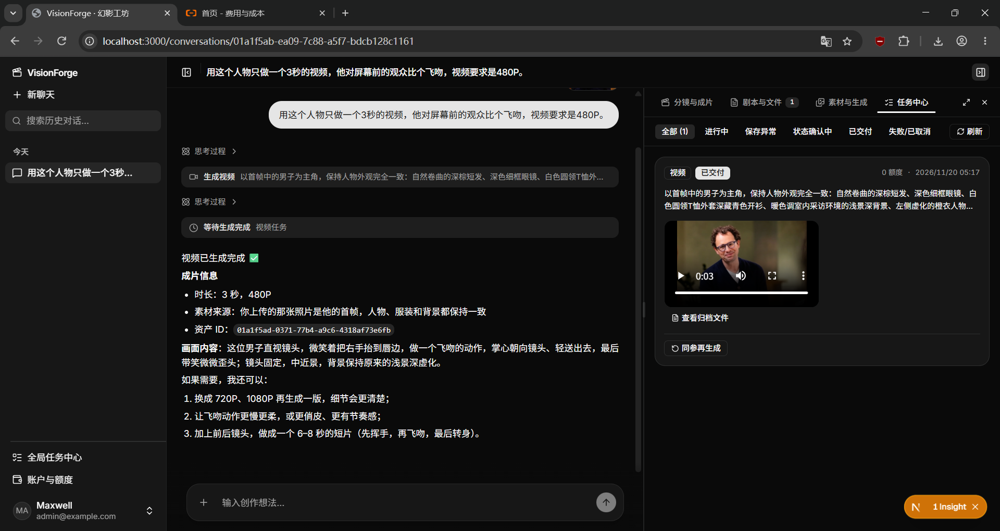

# VisionForge（幻影工坊）

**只需要一句话：让 AI 帮你写剧本、做分镜、做角色、做镜头，最后产出一个高质量的短片。**

[English](README.md) · [文档中心](docs/README.md) · [贡献指南](CONTRIBUTING.md)


---

## 演示



Agent 读取参考人像，生成 3 秒 480P 视频，并在会话的任务中心返回已交付的成片：

<video src="https://cdn.jsdelivr.net/gh/PageFaultDev/VisionForge@main/assets/demo.mp4" controls muted width="100%"></video>

如果内联播放器不可用，可[直接打开生成的视频](assets/demo.mp4)。

---

## 它能做什么

- 🎬 **一句话开拍** — 描述一支短片、一条广告或一个镜头，VisionForge 会一路推进到剧本、分镜、首帧、分镜视频和最终成片。
- 🧠 **有记忆的导演** — 多轮工具调用 Agent 记得角色、连续性和之前确认过的决定，不需要每次从头解释。
- 🎞️ **能改的分镜工作台** — 结构化 JSON 分镜、镜头级首帧与候选视频、会话旁边实时可编辑的画布。
- 🖼️ **想用哪个模型就用哪个** — OpenAI Responses/Images、火山方舟 Seedream 与 Seedance、阿里百炼万相，以及 DeepSeek、Qwen 等 OpenAI 兼容网关。
- ⚡ **实时、持久、可中断** — SSE 实时推送思考、工具进度和正文；Temporal 让付费调用和长任务跨越刷新与重启继续执行。
- 🧩 **一个会话就是一个完整片场** — 剧本、分镜、提示词、参考素材、候选片段和成片都隔离在会话内，边界清晰。
- 🛠️ **真正的任务中心** — 异步生成、重试、归档状态、视频合成与额度流水，全都可见、可恢复。
- 🔐 **自带管理后台** — 用户、模型路由、价格、告警、运行参数、审计日志和运维面板一应俱全。

不靠脆弱的提示词拼接，不丢进度，也不让你猜失败原因。

---

## 快速启动

### 1. 环境准备

- JDK `21`（仓库自带 `./mvnw`）
- Node.js `20+` 与 `pnpm`（`12.21.0`）
- Docker 与 Docker Compose
- 视频合成需要 `ffmpeg` 与 `ffprobe` 在 `PATH` 中

### 2. 启动基础设施

```sh
cp .env.example .env
docker compose up -d --wait postgres redis rustfs temporal temporal-ui
docker compose up rustfs-init
./mvnw -pl database flyway:migrate
```

- PostgreSQL：`localhost:5432`
- Redis：`localhost:6379`
- RustFS S3 / 控制台：`localhost:9000` / `localhost:9001`
- Temporal UI：[http://localhost:8233](http://localhost:8233)

### 3. 启动 API 与 Worker

```sh
export JWT_SECRET="$(openssl rand -base64 32)"
export MODEL_CONFIG_SECRET="$(openssl rand -base64 32)"

# 可选：创建首个管理员
export BOOTSTRAP_ADMIN_EMAIL="admin@example.com"
export BOOTSTRAP_ADMIN_PASSWORD="change-this-strong-password"

./mvnw -pl api spring-boot:run
./mvnw -pl worker spring-boot:run
```

### 4. 启动前端工作台

```sh
pnpm --dir frontend install --frozen-lockfile
pnpm --dir frontend dev
```

打开 [http://localhost:3000](http://localhost:3000)，登录后输入第一个想法即可开始。

> [!TIP]
> **本地媒体 Mock**：执行 `python scripts/mock_media_server.py --port 8000`，并在 Worker 设置 `MEDIA_ALLOW_HTTP=true`，即可在本地免付费跑通生图、生视频与成片全流程。**生产环境严禁开启 `MEDIA_ALLOW_HTTP`**。

### 5. 构建与测试

```sh
./mvnw -B test
pnpm --dir frontend lint
pnpm --dir frontend build
```

或者直接起完整容器栈：

```sh
docker compose -f docker-compose.prod.yaml up -d --build
```

---

## 技术栈

| 层次 | 选型 | 为什么 |
| --- | --- | --- |
| **后端** | Java 21、Spring Boot 4、MyBatis-Plus、Flyway | 快、稳、可观测的服务端底座 |
| **持久化工作流** | Temporal | 付费模型调用和长任务能跨越重启继续跑 |
| **数据** | PostgreSQL 18、Redis 7 | 可靠落库 + 实时事件分发 |
| **前端** | Next.js 16、React 19、TypeScript 5、Tailwind CSS 4、Base UI、Motion | 像一个真正的创作工作台，而不是一张表单 |
| **媒体** | OpenAI、火山方舟、阿里百炼、FFmpeg、RustFS / S3 | 换供应商不用重写产品 |
| **交付** | Docker Compose、Temporal UI | 一条命令拉起整套环境 |

---

## 文档

- [文档中心](docs/README.md)
- [总体架构](docs/ARCHITECTURE.md)
- [API 参考](docs/API_REFERENCE.md)
- [设计细节](docs/DESIGN_DETAILS.md)
- [开发与部署](docs/DEVELOPMENT_SETUP.md)
- [贡献指南](CONTRIBUTING.md)

---

## 许可证

[Apache License 2.0](LICENSE)。
