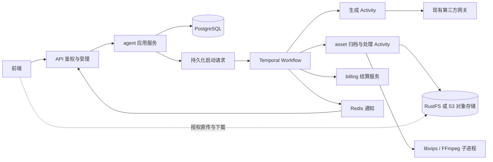

# 图片、视频生成与媒体资产方案

调研日期：2026-11-18。状态：对象存储与上传链路已实现（S3 兼容，RustFS 为本地默认）；媒体生成、归档、处理与计费仍为设计建议，尚未通过网关联调。

依据：重新阅读 `PROPOSAL.md`、`STANDARDS.md`，并核对模型客户端、工具执行器、Temporal Workflow、启动补偿、工作空间存储服务和 V1–V10 迁移。用户已确认继续使用现有第三方网关；尚未提供网关名称、媒体接口文档或真实响应样本。

> 模型变更说明：`PROPOSAL.md` 第 5 节已改为单用户隔离模型，不再有 workspace 和成员关系，创作文件改为会话级（`conversation_file`）。本文中出现的 `workspace_item`、`conversation_item`、按工作空间隔离等表述，一律按“会话级文件 + 按用户隔离”理解；媒体协议、任务生命周期、归档与计费设计不受此变更影响。

建议沿用八模块、API/Worker 双入口、PostgreSQL、Temporal、Redis 与 S3 兼容对象存储。主对话继续使用官方 OpenAI Java SDK 的 Responses SSE；Seedream、Seedance、GPT Image 和万相统一纳入媒体生成服务，通过协议适配器访问现有第三方网关。媒体类型、执行方式和上游协议分别建模，复用任务、归档、处理、交付与结算流程；媒体永久标识使用资产 ID，文件归属工作空间。

**本方案涉及一个需要明确采纳的提案调整：将“所有模型统一 Responses SSE”收窄为“主对话与 compact 统一 Responses SSE”；媒体工具按网关实际支持的图片/视频协议调用。** 若网关确实把媒体封装在 Responses 内，仍可实现 Responses 媒体适配器，但必须具备下文规定的任务标识、产物、恢复与用量语义。本文不直接改写现有提案中的协议约束。

## 1. 当前实现与改造落点

| 现状与代码位置 | 本次设计的衔接方式 |
| --- | --- |
| `agent/provider/OpenAiResponsesModelClient` 仅映射文本、推理、function call；SDK 已设置 `maxRetries(0)` | 保留文本链路；新增媒体适配器，不把生成文件放进 `ModelResponse.text` |
| `ModelDefinition` 是文本模型配置；默认模型唯一索引是全局的，token 上限为必填 | 扩展能力类型和模型路由；默认模型按用途区分，防止图片模型成为会话默认模型 |
| `ModelInputItem.Message` 只有字符串 content | 已确认主模型支持图片输入；增加受控的 `input_text` / `input_image` 内容块，本轮消息附带的图片由 provider 解析为短时 URL，仅传 `assetId` 不代表模型看到了图 |
| `AgentRunWorkflowImpl` 的工具 Activity 超时 2 分钟 | 生成工具只创建任务并返回 `taskId`；不在该 Activity 中等待视频或长时间图片请求 |
| `AgentToolExecutor` 先写 RUNNING，再执行副作用，最后写结果；RUNNING 重放直接报冲突 | 为生成工具建立可恢复的提交事务；不能仅依赖现有工具记录实现付费幂等 |
| `workflow_start_request.agent_run_id` 非空，补偿器只启动 `AgentRunWorkflow` | 扩展启动记录类型与分发；媒体任务拥有独立 Workflow |
| `WorkspaceItemService.create` 显式拒绝非文本 kind；V5 预留 `asset_id`，没有真实 asset 表 | 增加媒体发布服务，复用条目与不可变版本，不另建一套作品库 |
| `message` 是纯文本；会话查询当前主要按 workspace 过滤 | 增加媒体/任务引用，并先补齐会话可见性，防止任务卡片泄露私人素材 |
| `billing` 尚为模块骨架；Compose 只有 PostgreSQL、Redis | 图片阶段同时补最小额度账本、Temporal、对象存储及媒体 Worker 环境 |

路径均相对仓库，Java 类的完整包前缀为 `app.pagefault.visionforge`。当前代码事实以这些类和迁移为依据，提案中的候选实体不计为已实现。

## 2. 官方调用调研与网关边界

官方文档用于确认协议形态与能力差异，**不是现有网关的服务承诺**。以下 HTTP 示例用于说明协议，均未实际提交；模型 ID、路径、额度和鉴权必须映射到网关配置后才能执行。不要把官方 API Key 发送给第三方网关。

| 目标 | 已核实的官方调用方式 | 对内部设计的影响 |
| --- | --- | --- |
| Seedream | 方舟 `POST /api/v3/images/generations`，生成与参考图编辑共用入口 [S1] | 需要图片请求/结果适配；支持 URL 与 Base64 产物 |
| Seedance | 方舟 `POST /api/v3/contents/generations/tasks`，按 ID 查询，另有取消/删除入口 [S3–S5] | 需要远端任务 ID、持久化等待、状态映射和独立归档 |
| `image-2` | 此名先视作网关别名；若映射 OpenAI `gpt-image-2`，官方提供 Images 生成/编辑及 Responses 图片工具 [S7–S10] | 别名、实际模型、协议分别配置；不能仅换当前文本客户端的 model 字段 |
| 万相图片 | 2.7 图片支持同步结果与异步任务两种 HTTP 入口；较早 t2i 协议也存在异步图片任务 [S18][S19] | 图片不等于同步；按端点执行模式复用同一任务生命周期 |
| 万相视频 | 3.0 统一视频生成与 2.7 视频接口均采用提交任务后查询 [S20][S21] | 与 Seedance 共享远端任务执行策略，映射请求结构、状态与结果字段 |

### 2.1 Seedream

当前官方教程已列出 Seedream 5.5，模型 ID 为 `doubao-seedream-5-5-261028`；旧系列仍需按具体版本区分。[S2] 官方图片 API 的核心字段是 `model`、`prompt`、可选 `image`、`size`、`response_format`。`image` 接受可访问 URL 或 Data URL；URL 输出有效期为 24 小时。[S1]

```http
POST https://ark.cn-beijing.volces.com/api/v3/images/generations
Authorization: Bearer <ARK_API_KEY>
Content-Type: application/json

{
  "model": "doubao-seedream-5-5-261028",
  "prompt": "绘制一张极简风格的咖啡产品海报，保留包装上的文字",
  "image": ["https://media.example.com/<signed-reference>"],
  "size": "2K",
  "response_format": "url",
  "watermark": true
}
```

文生图省略 `image`；参考图编辑通过同一入口提交。适配器读取 `data[]` 中的 `url` 或 `b64_json`、尺寸、逐项错误及用量，不假设始终只有一个输出。[S1]

能力不能简单按“Seedream”统一：5.5 的普通生成不支持组图和流式；5.0 lite、4.5、4.0 的组图使用 `sequential_image_generation` 及 `max_images`。5.5 普通生成的尺寸档位是 1K/1.5K/2K，不能继承旧模型的 4K 配置。[S1] 首版按网关已开通版本提供单图生成/编辑，组图、透明背景、图层拆分按能力开关逐项开放。

### 2.2 Seedance

官方创建任务接口返回 `id`，之后使用 `GET /api/v3/contents/generations/tasks/{id}` 查询。创建参数将提示词放在 `content[].text`，参考图片放在 `image_url.url`，通过 role 区分首帧、尾帧或参考素材；规格使用独立字段。[S3][S6]

```http
POST https://ark.cn-beijing.volces.com/api/v3/contents/generations/tasks
Authorization: Bearer <ARK_API_KEY>
Content-Type: application/json

{
  "model": "doubao-seedance-2-5-260628",
  "content": [
    {"type": "text", "text": "镜头缓慢靠近杯子，蒸汽自然升起"},
    {
      "type": "image_url",
      "image_url": {"url": "https://media.example.com/<signed-first-frame>"},
      "role": "first_frame"
    }
  ],
  "resolution": "720p",
  "ratio": "adaptive",
  "duration": 5,
  "generate_audio": false,
  "return_last_frame": true
}
```

这是官方 2.5 首帧生视频的协议示例；网关侧必须换成已开通且映射到对应版本的模型 ID。文生视频去掉图片；首尾帧及多模态参考由能力目录校验。2.5 系列首帧/首尾帧、编辑和延长任务需 `ratio=adaptive`，编辑任务另有时长约束；不能将一种模式的规则套给所有视频任务。[S3]

查询状态包括 `queued/running/succeeded/failed/cancelled/expired`；成功从 `content.video_url` 获取文件，尾帧开启后从 `last_frame_url` 获取。视频 URL 有效期为 24 小时；普通任务 ID 保留 7 天，Draft 的规则另行规定。[S4]

**取消不是删除记录的同义词。** 官方 DELETE 仅能取消 queued 任务，running 不支持取消；对 succeeded/failed/expired 调用 DELETE 是删除记录。取消前的 GET 与 DELETE 仍有竞态，网关若无原子 cancel，应在适配结果中标明“不保证阻止执行”，保留已查询结果，禁止把 DELETE 成功直接当作无成本。[S5]

官方支持 `callback_url` 状态通知。[S3] 本系统首版建议 Timer 轮询，回调后置；启用回调时只把它作为唤醒提示，再经带凭证的查询确认结果。

### 2.3 image-2 / GPT Image

只有网关确认映射后，才应用 GPT Image 参数。OpenAI 官方 `gpt-image-2` 已于 **2026-11-10** 公告弃用，计划 **2027-02-10** 关闭；官方迁移目标为 `gpt-image-2.6-sunburst` 或 `gpt-image-2.6-flare`。该日期不能自动解释为第三方 `image-2` 的停服日期。[S7]

Images API 协议示例：

```http
POST https://api.openai.com/v1/images/generations
Authorization: Bearer <OPENAI_API_KEY>
Content-Type: application/json

{
  "model": "gpt-image-2",
  "prompt": "一张带有清晰中文标题的咖啡产品海报",
  "size": "1536x1024",
  "quality": "medium",
  "output_format": "png"
}
```

编辑使用 `POST /v1/images/edits`，常见传输为 multipart：`model`、`prompt`、`image[]=@reference.png`，局部编辑按支持情况附加 `mask`；mask 与输入尺寸、格式的约束由模型配置和适配器验证。[S8][S9] GPT Image 返回的 `b64_json` 在 Worker 内解码并存储，不能照搬其他模型的 `response_format=url` 假设。[S8]

`gpt-image-2` 的 quality 为 low/medium/high/auto；`input_fidelity` 应省略。它支持受约束的自定义尺寸：边长为 16 的倍数、最长边不超过 3840、长短边比不超过 3，总像素 655360–8294400；尺寸校验必须检查组合条件。[S11]

Responses 内置图片工具的概念示例：

```json
{
  "model": "<支持图片工具的主模型>",
  "input": "生成一张咖啡海报",
  "tools": [{"type": "image_generation", "model": "gpt-image-2"}],
  "stream": true,
  "store": false
}
```

顶层 model 是主模型，图片模型位于工具参数；图片结果是 `image_generation_call`，不是普通正文。[S11] 当前客户端没有映射该输出。建议首版保留自有 `generate_image` 工具执行额度预占，再进入独立图片任务；如网关只提供 Responses 图片工具，独立图片适配器也必须先预占并专门消费图片输出，不能让主对话绕过计费。

### 2.4 阿里云万相

本次核查覆盖当前公开的 `wan2.7-image` / `wan2.7-image-pro` 图片模型，以及 `wan3.0-video` / `wan3.0-video-prime` 视频模型，同时保留 2.6 t2i、2.7 视频和早期接口的适配区别。[S18–S21] 以实际网关开通情况选型，不把一个品牌固定为一种协议。

下列为阿里云官方北京地域协议示例。域名中的 `{WorkspaceId}` 是**阿里云百炼业务空间 ID**，不是 VisionForge 工作空间 ID；区域、凭证和端点必须配套。第三方网关可以重映射域名和模型名，不能把阿里云官方域名直接拼到已有网关的 baseUrl 后面。[S18]

图片同步调用：

```http
POST https://{WorkspaceId}.cn-beijing.maas.aliyuncs.com/api/v1/services/aigc/multimodal-generation/generation
Authorization: Bearer <DASHSCOPE_API_KEY>
Content-Type: application/json

{
  "model": "wan2.7-image-pro",
  "input": {
    "messages": [{
      "role": "user",
      "content": [{"text": "绘制一张极简风格的咖啡产品海报"}]
    }]
  },
  "parameters": {"size": "2K", "n": 1}
}
```

结果图片位于 `output.choices[].message.content[].image`；图像编辑在 content 中增加 `{ "image": "<授权素材URL>" }`。相同模型还提供异步入口 `/api/v1/services/aigc/image-generation/generation`，需 `X-DashScope-Async: enable`，返回 `output.task_id`；随后 GET `/api/v1/tasks/{task_id}`，成功后解析图片结果。[S18]

2.6 t2i 可用同步或异步 HTTP；2.5 及更早 t2i 的 HTTP 仅支持异步，使用 `/api/v1/services/aigc/text2image/image-synthesis` 和 `input.prompt`。因此不能把旧版请求体与新版 messages 结构混用；SDK 提供阻塞的 call/wait 方法，也不意味着底层 HTTP 是同步结果接口。[S19]

视频异步调用：

```http
POST https://{WorkspaceId}.cn-beijing.maas.aliyuncs.com/api/v1/services/aigc/video-generation/video-synthesis
Authorization: Bearer <DASHSCOPE_API_KEY>
Content-Type: application/json
X-DashScope-Async: enable

{
  "model": "wan3.0-video",
  "input": {
    "prompt": "镜头缓慢靠近杯子，蒸汽自然升起",
    "media": [{
      "type": "first_frame",
      "url": "https://media.example.com/<signed-first-frame>"
    }]
  },
  "parameters": {"resolution": "720P", "ratio": "adaptive", "duration": 5}
}
```

保存 `output.task_id`，查询 `/api/v1/tasks/{task_id}`，成功从 `output.video_url` 获取视频。万相 3.0 的任务查询有效期和视频链接有效期均为 24 小时；查询过期可返回 UNKNOWN，不能直接解释为“没有接单”。[S20] 2.7 图生视频与其采用相似的 `input.media` 结构，但能力、素材组合、模型 ID 和时长限制按版本校验。[S21]

阿里云取消入口为 `POST /api/v1/tasks/{task_id}/cancel`，仅支持 PENDING；这与 Seedance 的 DELETE 取消/删除语义不同。异步批量任务的总状态 SUCCEEDED 也可能包含子项失败，必须检查输出与 task_metrics，不能只看顶层状态。[S22]

万相 2.6 图片图文混排还有 SSE 路径，需要相应流式头与参数；这是传输/输出模式，不是一个新业务领域。[S23] 首版仍只开放所选模型已验证的纯媒体输出能力。

### 2.5 是否本质上属于同一类接口

**业务层属于同一类；协议层有可复用的结构，但并非全部线级兼容。** 统一业务语义是：`模型 + 提示词 + 输入素材 + 输出规格 → 生成执行 → 产物/用量`。本系统对外统一返回 202 + taskId，与上游是否在一次请求内完成无关。

| 比较层级 | 可以统一的部分 | 必须保留的差异 |
| --- | --- | --- |
| 业务能力 | GenerationTask、额度、引用、产物、归档与结算 | 图片/视频规格、输入角色、编辑/生成模式 |
| 执行方式 | 提交后取得结果，或持有 remote task 并查询 | 是否有可查询的远端任务、取消能力、保留期、幂等能力 |
| HTTP/SDK | 连接、鉴权、超时、限流和受控请求执行基础设施 | 路径、请求编码、字段、事件、错误和状态语义 |

Seedream 与 GPT Image 的 Images API 最接近：生成入口均为 `images/generations` 形态，共有 model/prompt/size 等字段及 data 数组。[S1][S8] 可复用 Images 风格的客户端基础设施，但 Seedream 的参考图在生成入口提交，GPT Image 编辑另走 edits；参数、返回格式与 SSE 能力仍按配置适配。[S1][S9]

Seedance 与万相异步图片/视频更接近：都是“提交 → 保存任务 ID → 查询 → 归档”。前者的 `content[]`、`id`、`content.video_url` 与后者的 `input`/`parameters`、`output.task_id`、输出结构需要映射。[S3][S4][S18][S20] JSON、Bearer 鉴权或 SSE 的相似性不能直接推导出 OpenAI Responses 协议兼容。

因此不按品牌建立四套执行系统，也不把“图片同步、视频异步”写进基础接口。统一业务模型 + 两种执行策略 + 少量协议适配器即可；若第三方网关已经统一请求协议，应直接复用网关适配器，以能力配置区分模型，无须为网关背后的每个品牌重复写适配器。

### 2.6 网关必须补齐的最小契约

接入前记录一份版本化配置和脱敏响应样本：

| 项目 | 必须明确的内容 |
| --- | --- |
| 路由 | base URL、鉴权、媒体接口路径、网关别名、实际模型/版本、区域；不假设与 `/responses` 共用完整路径 |
| 参数 | 单图/编辑/组图、首尾帧/参考视频/音频、尺寸时长组合、mask、输出格式、字段拒绝还是忽略 |
| 执行 | 同步结果或 task ID；查询与取消；状态枚举；GET 404 的含义；任务和结果 URL 的保留期 |
| 恢复 | 上游幂等键是否支持、有效期、是否能按客户端 ID 找回；请求超时如何核账 |
| 产物 | URL/Base64、结果数组、逐项失败、返回 MIME、刷新链接是否支持 |
| 用量 | 图片张数/规格、图像 token、视频秒数/分辨率/音频、失败和取消计费、网关账单标识 |
| 网络 | 网关抓取私有素材的时点与最大排队时间；输出域名；限流和 Retry-After；回调认证（若使用） |

官方未明确承诺且网关未证明的能力均标记 UNKNOWN，不以“兼容 OpenAI”推断其存在。缺少网关文档不阻碍本地任务、存储和处理实现，但阻止宣称网关适配已验证。

### 2.7 官方 SDK 与依赖选型

三个上游都提供官方 Java SDK，**媒体请求不需要手写 HTTP/SSE**。但 SDK 只封装传输和类型，不提供任务状态机、重启恢复、幂等、归档和结算；`REMOTE_TASK` 的轮询、状态映射与 UNKNOWN 处理仍属于本系统。

| 上游 | 官方 SDK | 坐标与版本 | 覆盖范围 |
| --- | --- | --- | --- |
| 火山方舟（Seedream / Seedance） | Ark Runtime Java SDK | `com.volcengine:ark-runtime`（当前 0.17.0；旧版 `com.volcengine:volcengine-java-sdk-ark-runtime`） | Chat、Responses、图片生成、视频任务、Embeddings、Files |
| OpenAI（GPT Image） | OpenAI 官方 Java SDK | `com.openai:openai-java`（仓库现有 4.99.0） | `images().generate()`、`images().edit()`、Responses 图片工具 |
| 阿里云百炼（万相图片 / 视频） | DashScope Java SDK | `com.alibaba:dashscope-sdk-java`（当前 2.23.2） | `ImageGeneration`、`VideoSynthesis`、异步任务提交与查询 |

版本号以 Maven Central 当前稳定版为准，生产构建必须锁定具体版本，不使用 `LATEST` 或开放区间。三家均为 Apache 2.0。

#### Ark SDK

- 客户端：`ArkService.volc()` / `ArkService.byteplus()` 自动配置区域；`ArkService.builder().baseUrl(...).apiKey(...)` 可指向网关。模型名是请求字段，网关别名直接传入。
- 图片：`service.generateImages(GenerateImagesRequest)` 返回 `ImagesResponse`；`data[]` 中带 `url` 或 `b64_json`。参考图通过 `image(...)` 提交，`size`、`responseFormat`、`outputFormat`、`watermark` 与 HTTP 字段一致。
- 视频：`service.createContentGenerationTask(CreateContentGenerationTaskRequest)` 返回任务 ID；`service.getContentGenerationTask(taskId)` 返回 `ContentGenerationTask`，状态为 `queued/running/succeeded/failed/cancelled/expired`。**SDK 示例本身就是手写轮询，不提供 Workflow 级等待。**
- Ark 同时提供 OpenAI 兼容入口，图片可以用 OpenAI SDK 调用 `/api/v3/images/generations`；**视频任务接口不是 OpenAI 协议**，OpenAI SDK 覆盖不了。
- 新 SDK 使用 `com.volcengine.ark.runtime.models.*`；旧版 `com.volcengine.ark.runtime.model.*` 不要与新包混用请求/响应类型。

#### OpenAI SDK

- 生成：`client.images().generate(ImageGenerateParams)`；编辑：`client.images().edit(ImageEditParams)`，编辑走 multipart，输入直接传字节流，不需要公网 URL。
- GPT Image 只返回 `b64_json`，SDK 不返回 `url`；Worker 必须解码并归档。
- 多图编辑存在已知问题：`ImageEditParams.Image.ofInputStreams(...)` 会让所有图片复用同一个 `filename` / `contentType`，混用 JPEG 与 PNG 时上游返回 400 MIME mismatch。变通方式是先统一转码；当前锁定的 4.99.0 是否已修复需要实测。
- 2.6 的 `complexity`、`markup`、SVG/GIF 等新字段若 typed builder 尚未跟上，使用 SDK 的附加请求属性透传，不退回手写 HTTP。
- SDK 的自动重试必须显式关闭或收紧（沿用文本客户端 `maxRetries(0)` 的原则），付费媒体请求不能盲目重试。

#### DashScope SDK

- 全局端点：`Constants.baseHttpApiUrl = "https://{WorkspaceId}.cn-beijing.maas.aliyuncs.com/api/v1"`；各区域 API Key 不通用。
- 图片：`ImageGenerationParam` + `ImageGeneration.call(param)` 为同步，`asyncCall(param)` 返回 `output.task_id`。SDK 的“同步”是内部封装 HTTP 异步流程并阻塞等待，不是上游存在同步接口。
- 视频：`VideoSynthesisParam` + `VideoSynthesis.call(param)` 阻塞到出片，`asyncCall(param)` 提交任务，`fetch(taskId, apiKey)` 查询结果（部分版本提供 `wait` 阻塞等待）。`VideoSynthesisParam.Media` 对应 `first_frame`、`last_frame`、`reference_image` 等类型。
- 版本下限：wan2.7 图片要求 DashScope Java SDK ≥ 2.22.13；wan3.0 视频要求 ≥ 2.22.31。统一锁定 2.23.2 及以上。
- `Constants.baseHttpApiUrl` 是全局静态配置；多地域部署时必须把 SDK 调用隔离在独立配置中，不能靠一个全局变量切换。

#### 选型规则

先确认网关协议，再决定 SDK；SDK 的 `baseUrl` 可以改，但路径和请求体不会自动适配。

| 能力 | 首选 | 备选 |
| --- | --- | --- |
| GPT Image | 现有 `openai-java` | 无（不要引入第二个 OpenAI SDK） |
| Seedream | 网关兼容 OpenAI Images 时用 `openai-java` | 仅支持 Ark 原生协议时用 `ark-runtime` |
| Seedance | `ark-runtime` | 网关自定义异步协议时写薄适配器 |
| 万相图片 | `dashscope-sdk-java` | 网关兼容 OpenAI Images 时用 `openai-java` |
| 万相视频 | `dashscope-sdk-java` | 网关自定义异步协议时写薄适配器 |

架构约束：

1. SDK 类型只能出现在 `agent.provider` 的适配器内部；`MediaGenerationProvider`、`GenerationRequest`、`RemoteTaskRef` 等领域类型不得引用 `com.openai`、`com.volcengine`、`com.alibaba`。
2. 每个进程只持有一个 SDK 客户端和连接池；Ark 的 `ArkService` 在关闭时调用 `shutdownExecutor()`，不要每次调用新建客户端。
3. 阻塞式 `call`（DashScope 图片/视频、Ark 同步图片）不得放进 2 分钟的工具 Activity；仍按 `INLINE_RESULT` / `REMOTE_TASK` 进入独立 Media Workflow。
4. SDK 的自动重试、超时和连接池必须显式配置；媒体请求不继承文本客户端的默认值。
5. 依赖风险：`ark-runtime` 传递 Jackson 2、Retrofit、OkHttp、RxJava 2；`dashscope-sdk-java` 传递 Gson、OkHttp、RxJava 2、Kotlin stdlib。项目使用 Jackson 3 与 Spring Boot 4，包名不同可以共存，但引入后必须执行 `./mvnw dependency:tree` 检查 Jackson 2、OkHttp、Kotlin 的版本收敛。
6. 依赖引入顺序：先接入 `openai-java` 的 GPT Image，再按网关实际协议接入 Ark 或 DashScope；不要为了“可能用到”同时引入两个媒体 SDK。

## 3. 架构与接口边界



模块职责建议：

- `agent.generation`：统一任务、尝试、输入/输出关系、业务状态、计费编排与 GenerationWorkflow；按执行方式分支，按媒体类型选择校验和处理配方。
- `agent.provider`：网关协议、模型能力校验、请求映射、错误归类；不对外暴露 SDK 类型。
- `asset.storage/upload/media/processing`：对象存储、上传会话、资产、变体、媒体探测与衍生处理；asset 不反向依赖 agent。
- `billing`：预占、供应商成本、用户结算；通过公开服务参与应用事务。
- `api`：任务/资产接口、SSE、后续回调入口；`worker` 只装配执行资源。

建议接口草图（领域接口，不是当前 SDK 的签名；引用类型省略定义）：

```java
interface MediaGenerationProvider {
    StartOutcome start(GenerationRequest request, ArtifactSink durableSink);
}
sealed interface StartOutcome {
    record ProviderCompleted(ProviderReceiptRef receipt) implements StartOutcome {}
    record ProviderPending(RemoteTaskRef task) implements StartOutcome {}
}
interface RemoteJobProvider extends MediaGenerationProvider {
    ProviderSnapshot query(RemoteTaskRef task, ArtifactSink durableSink);
}
interface CancellableJobProvider extends RemoteJobProvider {
    CancelOutcome requestCancel(RemoteTaskRef task);
}
// Completed 只代表上游完成；本地仍需归档、校验、发布、结算。
// GenerationRequest 含公共字段和 ImageSpec / VideoSpec 等类型化规格。
// receipt / snapshot 只保存持久化引用、状态与用量，不携带媒体字节。
```

注册表按协议与能力选择实现，query/cancel 是可选能力；同步图片不伪造远端任务 ID。统一流程为 `start → ProviderCompleted 或 ProviderPending + Timer/query → archive → process → publish → settle`。图像、视频可以保留类型化工具入口，底层复用同一个生成应用服务与 Workflow，不复制重试和账务逻辑。

两种执行策略分别是 `INLINE_RESULT`（在本次上游调用内读到完整产物，耗时可能很长）与 `REMOTE_TASK`（返回可查询任务 ID）。JSON/SSE 是独立传输选项：SSE 图片流不自动变成可恢复的远端任务。未知付费结果仍进入 UNKNOWN，不能用统一接口掩盖恢复能力差异。

SDK 选型与坐标见 §2.7：GPT Image 复用现有 `openai-java`；Seedream、Seedance 按网关协议选择 `openai-java` 或 `ark-runtime`；万相图片/视频使用 `dashscope-sdk-java`。所有 SDK 调用封装在 provider 适配器内，DTO 与字段/状态映射留在 provider 包。SDK 暴露的“同步”方法可能内部轮询并阻塞，`REMOTE_TASK` 路径只使用明确提交和查询方法；自动重试必须显式关闭或收紧。[S12] 这项 SDK 选择属于开头说明的媒体协议调整范围。

模型目录先在现有 `model_definition` 上兼容扩展，不要求立即拆出 provider_config：

```text
capability_type: CHAT | IMAGE | VIDEO
input_modalities: TEXT | TEXT_IMAGE        # CHAT 默认 TEXT_IMAGE
protocol: OPENAI_RESPONSES | OPENAI_IMAGES | ARK_IMAGES | ARK_VIDEO_TASKS
          | DASHSCOPE_IMAGE_MESSAGES | DASHSCOPE_T2I | DASHSCOPE_VIDEO | GATEWAY_CUSTOM
execution_mode: INLINE_RESULT | REMOTE_TASK
response_transport: JSON | SSE
request_encoding: JSON | MULTIPART
model_alias, provider_model_id, config_revision, capability_schema_version
capabilities: 输入角色/张数/字节数/尺寸/时长/格式/流式/查询/取消/幂等等
default_parameters, allowed_parameters, price_rule_id, deprecation_at, retirement_at
```

默认模型索引按 capability_type 唯一；已有行回填 CHAT，文本 token 字段只对 CHAT 必填。对话选模显式过滤 CHAT 且要求图片输入能力；生成任务冻结模型配置版本和价格版本，密钥只保存引用。扩展参数经过白名单和组合校验，模型不能指定 baseUrl、callbackUrl、供应商凭证或对象键。模型升级是配置变更与回归测试，不能静默把历史任务指向新版本。

## 4. 生成任务与可靠执行

### 4.1 受理事务和生命周期

```text
校验身份、模型能力、输入资产、实际提示词和预算
  → 本地事务：幂等记录 + generation_task + 输入引用保护 + 额度预占
             + workflow_start_request + 工具受理结果（若来自工具）
  → 提交事务
  → 尝试启动独立 Workflow，失败由补偿器恢复
  → 返回 HTTP 202 / 工具 ACCEPTED 与 taskId
```

涉及跨模块数据时由 agent 应用服务协调 asset、billing 的公开服务，在同一业务库和 Spring 事务中完成本地写入，不跨模块使用 Mapper。该事务不能包含供应商 HTTP、对象传输或 Temporal 启动。配额不足时整个受理事务回滚。

三层幂等分别保证：

1. API：`(workspace_id, user_id, operation, idempotency_key)` 唯一，保存请求指纹；同键同内容返回原任务，同键不同内容返回 409。
2. 工具：`(agent_run_id, tool_call_id)` 唯一，任务与 ACCEPTED 工具结果在同一事务写入。调整生成工具执行路径；不能在已创建任务后因 executor 退出而留下永远 RUNNING 的调用。历史 RUNNING 记录通过稳定工具标识查找已建任务并补结果，无任务时按提交事务边界恢复。
3. 上游：attempt ID 派生稳定客户端请求标识；只有网关明确支持幂等时才作为上游幂等键。内部唯一键不能解决供应商已接单但本地丢失响应的问题。

先扩展启动表：添加 `workflow_type`、`business_id`、`input_schema_version`，回填现有行，放宽 agent_run_id 非空约束，增加 `(workflow_type, business_id)` 唯一键。补偿器通过受控类型注册表分发，不能使用数据库中的任意类名。启动前核对业务状态，已终态的业务不能因 Temporal 历史过期被再次执行。

上传处理的编排入口也由 agent 应用服务协调 asset：创建 processing_job 与启动请求同事务提交；asset 只返回处理命令和结果，不调用 agent。Worker 注册 asset 提供的处理实现，保持依赖方向。

### 4.2 状态不要混成一个“成功”

`generation_task` 对外阶段建议：

```text
PENDING → SUBMITTING → RUNNING → ARCHIVING → PROCESSING → SUCCEEDED
                      ↘ FAILED / CANCELLED
SUBMITTING → UNKNOWN
ARCHIVING → ARCHIVE_FAILED → ARCHIVING
PROCESSING → PARTIAL_SUCCEEDED / DELIVERY_FAILED
```

该图只展示主要路径；同步图片可从 SUBMITTING 直接进入 ARCHIVING，提交前取消可从 PENDING 进入 CANCELLED。状态迁移通过期望状态与版本号做 CAS，迟到通知不能把终态改回 RUNNING。

另外独立保存：

- `provider_status`：上游原始状态及归一化状态。
- `delivery_status`：未归档、已归档、必需处理完成、部分交付、交付失败。
- `billing_status`：RESERVED / PENDING_RECONCILIATION / SETTLED / RELEASED。
- `cancel_status`：NONE / REQUESTED / CONFIRMED / UNSUPPORTED / TOO_LATE / UNKNOWN。

`SUCCEEDED` 表示所有要求的输出已归档且通过必需校验，并已发布为可访问条目；结算可短暂处于处理中。缩略图等非关键处理失败时仍可交付原文件，通过 `processingWarnings` 表达，不把可交付图片永久卡住。多图部分失败时输出逐项记录，计费按实际规则核算。

### 4.3 一次调用返回产物的执行分支

适用于已选择同步结果端点的 Seedream、GPT Image、万相图片等；这是统一 GenerationWorkflow 的分支，不是图片专用的固定执行模型。

1. 读取冻结请求，解析并保护输入版本，按需生成符合模型限制的输入变体。
2. 写入 attempt 和 SUBMITTING，再执行一次付费请求。
3. URL 结果先保存受限的产物清单、request ID、用量和到期时间，再由归档 Activity 下载；敏感 URL 加密保存且不写日志。
4. Base64 结果在同一个生成 Activity 内通过 asset 的 durable sink 保存到私有暂存对象，持久化 receipt 后仅向 Workflow 返回引用。不能把 Base64 返回到 Temporal，也不能先把 SDK 整个响应序列化进数据库。
5. 独立校验、归档、发布条目；生成缩略图；结算。归档失败只恢复这一步。

同步图片 SDK 可能一次在内存中构建 Base64 字符串，首版限制尺寸、批量数和并发，按实际内存测量设置上限；“流式写 S3”并不能消除 SDK 已分配的内存。预览增量不是最终产物，不驱动成功结算。

如果进程在上游已完成、结果尚未持久化时退出，又没有可查询的任务 ID 或上游幂等能力，进入 UNKNOWN。不能宣称同步图片生成天然可恢复，也不能以重新发送请求冒充归档重试。

### 4.4 远端任务的执行分支

适用于 Seedance、万相视频和万相异步图片等。流程与媒体类型独立，归档后再选择图片或视频处理配方。

1. 提交并尽快保存远端任务 ID、provider connection ID 与 attempt ID。
2. Workflow Timer 等待，短 Activity 查询状态；退避、抖动和查询频率按协议配置。例如万相视频文档建议约 15 秒查询间隔；其他路由可从 3 秒起增长至 30 秒，但仍以网关实际限流为准。[S20]
3. 成功后立即保存产物清单并进入归档；文件下载、探测、封面和必要转码单独执行。
4. 到达本地等待期限后进入待核对，不自动当作上游失败。已有 remote ID 的任务继续低频核对，避免结果过期。
5. 用户取消与结果到达并发时，记录取消事实和上游结果；已经产生的产物可先保全，成本按账单确认。

Activity 不循环 sleep 等整个视频生成完成。大文件传输和处理设置心跳、执行超时；Workflow 仅传 ID、状态与小型 DTO。执行长期持续时评估 Continue-As-New，不能把永久会话塞进一个 Workflow。

回调后置：验证来源与认证、限制负载，持久化去重记录后返回，再唤醒 Workflow。缺少可靠签名时只接受为查询提示，不能信任回调中的成功状态、费用或下载 URL。重复、乱序或丢失回调由查询补齐。

### 4.5 重试、取消与 Agent 续跑

| 操作 | 初始恢复策略 |
| --- | --- |
| 图片生成、视频提交 | SDK 重试为 0，Temporal 提交 Activity 最大尝试 1；有明确上游幂等协议后才开放受控重试 |
| 查询任务 | 有界退避；429 尊重 Retry-After，401/403 等配置错误不循环重试 |
| 下载、校验、对象写入、条目发布 | 可重试，必须通过 receipt、校验值和唯一键实现幂等 |
| 转码、缩略图 | 通过输入 checksum、recipe 版本和输出类型去重，重试不调用模型 |
| 结算 | 账本业务键唯一，可独立重试；不因结算异常重复生成 |
| 付费请求超时/连接断开/不明确 5xx | UNKNOWN，先按已持久化 ID 或上游幂等标识查证；不能自动切换供应商再生成 |

取消请求是持久化业务命令。API 提交 `cancel_requested_at`，Workflow 用 Signal 加速感知，轮询同时读取该标志兜底；不能依赖一次不可恢复的 Signal。提交前取消释放预占；提交后等待上游取消结论与用量。正在运行但不能取消的任务显示“已请求取消，上游仍在处理”，本地继续核账。

统一 GenerationWorkflow 独立于 AgentRun。MVP 默认后台返回 ACCEPTED，AgentRun 可完成；生成完成更新任务卡片，原 run 不再接收 Signal。自动文字解读首版不默认启动，用户继续对话即可查询结果。

如果当前用户明确要求“先生成图，再用它生成视频”，需要增加 `await_generation` 工具及 Workflow 等待分支：工具分发返回受控的等待指令，Workflow 用 Timer/完成通知等待，完成后持久化同一 call 的最终结果再继续模型。不能让模型持续调用 get_generation 消耗 token，也不能在现有 2 分钟工具 Activity 内阻塞。后续自动续跑使用唯一 `(generation_task_id, continuation_kind)` 键，且遵守现有会话串行约束；会话忙时排队，不插入竞争 run。

## 5. 数据模型与来源追溯

以下为新增表/字段建议，迁移编号实施时从当前最大版本后分配，不修改 V1–V10。新业务主键 UUIDv7，时间 TIMESTAMPTZ，金额 NUMERIC(20,6)，遵守 `STANDARDS.md`。

| 表及归属 | 关键内容与约束 |
| --- | --- |
| `generation_task` / agent | workspace、creator、可空 conversation/run/tool、任务类型、配置/价格快照、实际提示词、参数、状态版本、取消标志、预算、工作流 ID、原任务 ID；API 幂等键与工具来源分别唯一 |
| `generation_attempt` / agent | task、attempt_no、provider connection、model ID、request ID、remote ID、提交状态/时间、用量、归档清单引用、错误分类；UNIQUE(task_id, attempt_no)，远端标识按连接作用域唯一 |
| `generation_input` / agent | task、item_version_id、asset_id、role、ordinal、mask、裁剪/预处理配置和实际输入变体；拒绝不同 workspace 引用 |
| `generation_output` / agent | attempt、output_index、asset_id、发布后的 item/version、逐项状态/错误；UNIQUE(attempt_id, output_index) |
| `asset` / asset | workspace、creator、bucket/key、可选 object version ID、MIME、字节数、SHA-256、宽高/时长/编码、状态、来源业务 ID；稳定存储定位唯一 |
| `asset_variant` / asset | parent_asset_id、variant_asset_id、用途、recipe_version、参数 hash；变体文件也有 asset 行，UNIQUE(parent, recipe, params_hash) |
| `asset_reference` / asset | asset、owner_type、owner_id、引用目的、释放时间；UNIQUE(asset_id, owner_type, owner_id, purpose)，用于 GC 保护，不自动授予访问权 |
| `upload_session` / asset | workspace、creator、暂存键、multipart upload ID、预期大小/校验值、额度预留、到期时间、状态、最终资产 ID |
| `processing_job` / asset | 输入资产、recipe、参数、状态、attempt、心跳/错误、输出资产；同配方幂等，处理失败不影响原始文件 |
| `message_part` / agent | 追加 TEXT/ASSET_REFERENCE/GENERATION_TASK 类型及序号；历史 content 保留，媒体结果不改写旧消息正文 |
| billing 表 | account、reservation、ledger、usage_record；预占/供应商成本/用户扣费不同记录，账本操作业务键唯一 |

媒体版本只保存 `asset_id`，通过 asset 定位对象；V5 的 `object_key` 预留给大型文本外置，不与媒体 asset 同时充当两个可修改的文件地址。新增媒体版本接口只允许引用同空间、已校验且有权限的资产。

生成输入冻结为具体 item_version_id 与 asset_id；对一个条目“跟随最新”的会话绑定不影响已受理任务。输出默认新条目；只有显式要求修改指定作品时才基于 baseVersion 发布新版本。发布遇到并发版本冲突时保留产物，返回“待选择发布位置”，禁止覆盖别人版本或重新生成。

首版不做跨用户内容去重；相同文件可以拥有不同资产 ID 和权限归属。原始生成参数、用户原话、优化提示词分别保留；供应商响应只保存经过裁剪/脱敏的必要字段。短期签名 URL 不进入永久版本、聊天历史或 Temporal 输入。

## 6. 对象存储、上传与归档

### 6.1 存储选型与地址

已实现 `asset.storage.ObjectStorage` 端口和 `S3ObjectStorage` 适配器，以 AWS SDK for Java v2 的 S3 client/presigner 访问 RustFS；本地默认 RustFS，但领域代码只依赖端口，未来可替换为其他对象存储。官方 AWS Java 示例涵盖预签名 GET/PUT。[S13] RustFS 官方兼容矩阵区分已测试、计划支持和已排除项目，因此必须针对选定镜像验收，不能把“S3 兼容”当作所有功能可用。[S14]

首版一个私有媒体 bucket；对象键只由服务端分配：

```text
users/{userId}/conversations/{conversationId}/uploads/{uploadSessionId}/{filename}
users/{userId}/conversations/{conversationId}/assets/{assetId}/original.{ext}
users/{userId}/conversations/{conversationId}/generations/{taskId}/{outputId}.{ext}
users/{userId}/conversations/{conversationId}/variants/{assetId}/{variant}.{ext}
```

`uploads/` 是预签名 PUT 的临时键；complete 时把对象复制到 `assets/.../original.*`，正式资产不会再接受客户端写入。生成结果和变体的键已预留，归档流程尚未实现。

bucket/key 只在服务端，客户端使用业务 ID。数据库不把对象公开 URL 存为永久地址。配置区分内部 endpoint（Worker 读写）和外部 endpoint（浏览器/供应商可达）；预签名必须用最终实际访问的 host/path 生成，不能签完再字符串替换域名。所有正式桶默认私有。

### 6.2 上传：直传、验证、不可变发布

1. 已实现 `POST /api/v1/conversations/{conversationId}/uploads`：验证声明格式/大小，分配临时键并签发短时 presigned PUT。
2. 浏览器直传。小文件普通 PUT，大视频后续按配置启用 multipart；签名绑定 Content-Type。客户端不能自定目标桶、正式对象键或随意扩大片数。
3. 已实现 `POST /api/v1/conversations/{conversationId}/uploads/{uploadSessionId}/complete`：HEAD 校验实际大小和 Content-Type，把临时对象复制到正式资产键并标记 READY；重复调用是幂等的。真实解码/ffprobe 和 SHA-256 强校验仍待补充，后端未返回 checksum 时 `asset.checksum` 可为空。
4. 发布前将校验对象固定为不可变来源：优先使用经过验收的对象 version ID/条件复制；若目标存储不支持，则受控下载到 Worker 临时文件，校验后上传正式键并再次校验。不能 HEAD 完后就把仍可被预签名 PUT 覆盖的 staging key 作为正式资产。
5. 同一数据库事务将 asset 置 READY，创建 item/version、引用和可选会话绑定，提交存储额度；清理 staging 进入独立幂等步骤。并发 complete 返回同一资产与条目。

预签名 PUT 不一定能实现严格的上传大小上限；需要服务端验收、额度和清理兜底，若业务要求硬限制则改用支持条件策略的 POST 或受限上传代理，不能只信客户端 Content-Length。multipart Complete/Abort 由服务端控制。失败与过期上传释放存储预留。

### 6.3 生成结果归档

先以 `(attempt_id, output_index)` 创建唯一产物和 asset 的 STAGING 记录，再使用固定对象键写入。URL 下载以流式/有界临时文件方式执行，限制总字节、时间和解码资源；校验 MIME、hash 与元数据后发布。S3 写入与 DB 提交不能形成同一事务，因此必须能够核对：

| 故障窗口 | 恢复动作 |
| --- | --- |
| 文件已写，DB 未 READY | 从已存在的 asset/receipt 定位对象，验证 hash 后补确认；不重复建版本 |
| DB 有记录但对象不存在 | 保持 STAGING/MISSING，重试归档或修复，不能返回可下载成功 |
| 已归档，条目发布失败 | 通过唯一发布键重试；产物继续受引用保护 |
| 供应商 URL 已过期 | 有 remote ID 时先查询是否可取新 URL；不能假设查询必然刷新，无法恢复则记录交付失败与真实成本 |
| 多个结果只归档成功一部分 | 各输出独立重试，保留已完成结果，不重做整批生成 |

下载客户端限制协议为 HTTPS、配置可接受的供应商输出域名，并逐次校验 DNS 解析、目标 IP 和重定向；禁止访问本机、内网、链路本地及云元数据地址。大文件下载与媒体解码分开隔离，媒体解码进程关闭外网访问。

### 6.4 给浏览器和供应商访问

浏览器访问先经业务鉴权，再返回短时 GET URL 与 expiresAt；默认建议 5–15 分钟，可配置。视频播放器应支持 Range，URL 过期后重新获取；测试实际 Range/206、CORS、Content-Type 和 Content-Disposition。原文件下载与页面预览用不同用途的变体。

供应商素材读取授权独立于浏览器授权：覆盖排队与抓取窗口，按角色仅暴露必要的固定版本。没有公网入口的私有 RustFS 地址不能直接给网关读取。小图可在网关允许时使用 Data URL；大图/视频通过公网 HTTPS 对象域名、受限媒体出口，或经验证的供应商文件上传 API。

若排队窗口超过可签发有效期，使用有期限、可撤销的素材读取租约，由网关可达的出口解析固定资产；或先上传供应商文件服务。授权到期后不立即删除任务输入，实际存储引用保护持续到任务与核账结束。主模型、浏览器和供应商分别使用各自的访问范围，不共享长期凭证。

## 7. 图片和视频处理

处理在 asset 中实现，以固定配方调用工具，Worker 负责编排和资源限制。建议图片使用 libvips，视频使用 FFmpeg/ffprobe；libvips 提供缩略图处理，ffprobe 可输出结构化媒体信息，FFmpeg 的 MP4 faststart 可将索引移至文件前部。[S15–S17] 具体可执行版本在镜像中固定，并记录到 recipe_version。

| 场景 | 首版处理 |
| --- | --- |
| 图片导入/生成 | 真正解码；提取尺寸、帧数、透明度、色彩/方向；原文件保留；生成校正方向和 sRGB 的预览 |
| 图片浏览 | 建议 320 px 缩略图和最长边 1280 px 预览；默认 WebP，需要时 JPEG；保留透明通道 |
| 图片送模型 | 根据目标能力生成缩放/编码变体；默认等比缩放，不静默裁剪；记录所用资产与变换参数 |
| 视频导入/生成 | ffprobe 探测容器、编码、时长、宽高、帧率、旋转与音轨；保存原文件 |
| 视频浏览 | 一张封面；已兼容的 MP4 仅按需 remux/faststart，否则生成 H.264/AAC、yuv420p 的 MP4 预览；无音轨不人为合成音频 |
| 视频送模型 | 根据模型要求生成受限时长/尺寸/编码变体；裁剪片段记录时间范围；音轨单独检查 |

原片作为下载和追溯依据，展示变体不覆盖原片。首版用 MP4 + Range，暂不引入 HLS/DASH、自适应码率、分布式剪辑或 GPU 转码；视频规模和真实播放需求出现后再扩展。

媒体内容不可信：限制字节、总像素、帧数、时长、CPU、内存、临时磁盘和进程执行时间；对动画图片和异常文件明确拒绝或显式转换。使用参数数组启动进程，不拼 shell 命令；禁止从模型参数直接生成 FFmpeg filtergraph。子进程只读输入、写专属临时目录、无外网、最小权限，停止时终止进程树并回收临时文件。预览移除不必要 EXIF/GPS，原文件只在原权限范围内保留。

Worker 仍使用同一模块与镜像，可按配置拆成三个资源池：

```text
vf-agent-control    对话、工具受理与 Workflow 推进
vf-media-io         供应商请求、轮询、文件归档
vf-media-process    解码、缩略图、转码
```

小规模可在一个进程注册多个 Task Queue；正式部署建议将 media-process 配置为独立 Worker 副本，避免转码耗尽对话服务资源。初始图片处理并发 2、视频转码并发 1，再根据测量调整；不能直接复用当前通用 Activity 并发上限。

## 8. 权限、引用、清理与费用

### 8.1 权限和保留

workspaceId 来自 JWT/服务端执行上下文。访问资产、变体、下载链接和生成任务时，都要检查所属空间以及 PRIVATE/WORKSPACE 可见性；对象键前缀不构成授权。绑定会话不自动授予素材读取权。任务详情中的提示词、输入和错误信息也属于私有数据。

同一资产可被多个条目引用时，下载授权通过一个当前用户可见的有效条目关系证明；没有条目的暂存资产仅上传者/授权执行可用。派生变体继承源资产的访问规则；输出默认 PRIVATE，不因为关联共享会话或完成任务自动发布。平台管理员按现有规则显式进入空间并审计。

建议首版生命周期策略（产品默认值，可配置）：

- 上传会话、未完成分片、staging 孤儿超过 24 小时后清理；先核对上传/归档是否仍活跃。
- 正式资产显式删除后保留 7 天回收期；对象物理删除前再次检查所有条目版本、输入引用与处理任务。
- 任务结束释放执行期 pin，但其来源追溯引用继续保留，直到任务/历史按产品保留策略删除；否则会出现“历史参数存在、输入已丢失”。
- 删除会话仅删除绑定；取消任务不删除已有付费产物；归档 workspace 不自动删除媒体。
- 孤儿回收是 DB 标记、宽限期、复核、删除的流程；S3 生命周期规则只作为兜底，不独立删除仍被引用的正式对象。

建议先上线媒体专用 `asset_reference`，由 asset 统一检查引用；禁止 GC 跨模块 JOIN 读取 generation_task。任务受理事务增 pin，终态事务更新 pin。备份恢复时同时验证数据库与对象的一致性，并在恢复/核对期间暂停 GC。

### 8.2 费用模型

预占金额按选定模型、冻结参数与价格规则计算：图片按张/规格或图像 token；视频按实际计费单位、分辨率、时长和音频模式。不同模型不可统一成“输出 token × 文本单价”。官方价格不能代替第三方网关的实际报价，本文不提供未经核实的固定单价。

网关实际成本、用户扣费、存储占用分别记录。推荐首版用户规则为“按可交付产物结算”，交付失败但网关已收费记平台成本；如果采用按上游完成收费，必须在生成前明确展示。所有规则带版本，不能因后台配置修改而回写历史账目。

建议处理语义：

| 情况 | 账务动作 |
| --- | --- |
| 未提交即取消/参数校验失败 | 释放预占，无供应商成本 |
| 确认取消或确认失败 | 根据网关实际用量与收费规则结算并释放余额，不能推断免费 |
| 上游成功、归档重试中 | 保留预占，记录已知供应商成本；不再次预占生成费用 |
| 部分产物交付 | 按逐项用量和已授权价格结算，剩余释放 |
| UNKNOWN、取消结论未知 | 转待核账，不自动全额释放；达到配置的核账期限后进入人工处理队列 |
| 最终交付失败 | 保留真实上游成本，按本系统用户收费规则释放/退款；账本追加补偿流水 |

持久化 billing reservation ID；`reserve/settle/release/refund` 分别有唯一业务键。并发预占在数据库锁/条件更新下检查余额；Redis 限流不能代替额度约束。增加单任务、单 run 和工作空间预算上限，在工具侧强制执行，避免当前无轮数上限的 Agent Loop 连续生成超预算媒体。

## 9. API、工具与前端衔接

业务路径前缀均为 `/api/v1/workspaces/{workspaceId}`：

| 接口 | 语义 |
| --- | --- |
| `POST /upload-sessions` | 创建上传会话，201，返回上传方式和到期时间 |
| `POST /upload-sessions/{id}/parts` | 按白名单分片编号签名；限制并发、数量和累计大小 |
| `POST /upload-sessions/{id}/complete` | 202，异步验证与发布，重复请求返回同一结果 |
| `GET /upload-sessions/{id}` | 验证状态、处理状态、最终 asset/item 引用 |
| `POST /upload-sessions/{id}/abort` | 幂等终止上传，200 包络；已发布不能通过此入口删除 |
| `POST /generation-tasks` | 202 + Location，支持 Idempotency-Key |
| `GET /generation-tasks[/{id}]` | 游标列表或任务详情，包含各状态、输出引用和可执行操作 |
| `POST /generation-tasks/{id}/cancel` | 202 接收取消命令；已终态重复请求可返回 200 当前结果 |
| `POST /generation-tasks/{id}/retry-archive` | 202，只恢复归档，不重新生成；支持幂等 |
| `GET /assets/{id}` | 鉴权后返回元数据及可用变体 |
| `POST /assets/{id}/access` | 200，返回指定用途的短时 URL 与 expiresAt |
| `GET /generation-tasks/{id}/events` | 可选任务 SSE，避免依赖已经关闭的 AgentRun SSE |

“再生成”使用新的 `POST /generation-tasks` 请求和新幂等键，携带 `sourceTaskId`，保留原任务。UNKNOWN 任务不能被 UI 自动重试为新付费请求。

请求示例仅为本系统 DTO，与上游 JSON 分离：

```json
{
  "type": "VIDEO",
  "modelDefinitionId": "<uuid>",
  "prompt": "让杯中的蒸汽缓慢上升",
  "inputs": [
    {"itemId": "<uuid>", "version": 3, "role": "FIRST_FRAME"}
  ],
  "parameters": {"durationSeconds": 5, "resolution": "720p", "audio": false},
  "conversationId": "<optional uuid>"
}
```

不接受 body 中的 workspaceId、任意来源 URL、供应商 task ID 或 callbackUrl。API/工具显式引用素材；外部 URL 导入若未来开放，应作为独立受控导入任务。

工具新增 `generate_image`、`generate_video`、`get_generation`、`cancel_generation`、`inspect_asset`，依赖任务的等待由第 4.5 节机制处理。工具结果只返回 ACCEPTED/SUCCEEDED/PARTIAL 等明确状态及 task/item/version/asset 引用。`inspect_asset` 返回元数据不等于视觉理解；需要主模型看图时，provider 在调用时解析已授权预览为真正 `input_image`，不在聊天或摘要中长期保存签名 URL。用户本轮消息附带的图片通过消息附件参与输入，历史消息默认只回放文本。视频理解暂按受控抽帧提供，不假设 Responses 可以直接接受任意视频文件。

任务通知先落库再经 Redis 推送小型状态事件，使用 stateVersion 去重。断线后 GET 恢复状态；首版不承诺事件重放。新增 SSE 按 `STANDARDS.md` 包含 type/code/message/data/traceId/timestamp，终态明确；现有聊天 SSE 的旧简化格式需要兼容迁移，不借本次媒体功能直接破坏旧客户端。

错误至少区分 `GENERATION_CAPABILITY_UNSUPPORTED`、`GENERATION_INPUT_INVALID`、`GENERATION_SUBMIT_UNKNOWN`、`GENERATION_CANCEL_UNSUPPORTED`、`GENERATION_ARCHIVE_FAILED`、`ASSET_VALIDATION_FAILED`、`ASSET_STORAGE_QUOTA_EXCEEDED`。跨空间资源隐藏为 404；路径 workspaceId 与 token 不一致按现有提案返回 403，两种情况分别处理。异步任务失败写在任务资源中，GET 本身仍可成功返回该资源。

## 10. 实施顺序与验收

产品范围以 [视频创作工坊三阶段计划](PRODUCT_ROADMAP.md) 为准。下面 A–F 是第一阶段“单镜头创作闭环”的工程拆分；图片、图生视频、候选比较、前端、归档、版本和费用共同构成第一阶段验收，不能仅完成图片接口就标记该阶段完成。主对话与 compact 保留 Responses SSE，媒体协议适配边界已由产品路线采纳。

| 阶段 | 交付 | 验收重点 |
| --- | --- | --- |
| A. 网关契约与基础设施 | 记录实际模型映射、响应/错误/用量样本；确定媒体协议；RustFS/S3 和 Temporal 环境；补会话权限 | 不调用未授权的付费测试；有测试额度后执行最小联调；存储支持所需接口 |
| B. 资产闭环 | asset/upload_session/variant/reference、直传验证、媒体版本、图片预览、存储配额、GC | 同一文件 complete 重试只发布一次；签名上传重放不能修改正式资产；跨空间/私有越权被拒绝 |
| C. 图片闭环 | 最小 billing、通用启动补偿、工具提交事务、一个网关适配器、统一 GenerationWorkflow、任务卡片 | 选择网关已开通的 Seedream、image-2 或万相图片路由；未知提交不重复扣费；归档失败单独恢复 |
| D. 多协议与多模态输入 | 第二图片协议、万相异步图片策略验证、编辑/参考图、能力 Schema、主模型 input_image | 同一业务 DTO 正确映射不同上游；同类图片可选 INLINE_RESULT 或 REMOTE_TASK；图片真实进入模型输入 |
| E. 视频闭环 | Seedance/万相按已开通模型接入、复用远端任务策略、ffprobe/封面/播放变体、等待工具 | 对话完成/浏览器断线不取消视频；取消语义按协议处理；依赖任务可继续图生视频 |
| F. 上线准备 | 用量核对、超时人工入口、限流、故障恢复、备份恢复 | 能恢复数据库与对象对应关系；升级后已有 Workflow 可继续 |

SDK 版本在阶段 A 锁定：GPT Image 复用现有 `openai-java`；Seedream、Seedance 与万相按 §2.7 的网关协议判断结果引入 `ark-runtime` 或 `dashscope-sdk-java`。每个 SDK 至少有一个只验证请求构造、字段映射和错误归类的离线测试，真实付费调用仍受阶段 A 的授权约束。

基础设施兼容测试必须覆盖实际部署版本的 PUT/GET/HEAD/DELETE、预签名外部域名、multipart Complete/Abort、Range/206、CORS、条件复制或替代不可变上传方案、checksum 与超时重试。生命周期规则不支持时用应用清理任务，不能阻断原始资产读写。

必须覆盖的故障测试：

1. 本地事务提交后 Temporal 不可用：启动补偿最终只启动一次有效业务流程。
2. 供应商接单后、本地保存 ID 前 Worker 崩溃：进入 UNKNOWN，不二次提交。
3. 任务与工具结果已提交但 Activity 未确认：重放拿到原 taskId，不再次预占。
4. 上游成功、对象存储断开：恢复后只重试下载/归档；过期 URL 不触发重新生成。
5. 对象已写、DB 回滚：核对 receipt 后补发布或安全回收，无重复版本。
6. 查询成功与取消并发：状态不回退，记录可能的真实成本和已产生文件。
7. 编码异常、超大像素或转码进程卡死：终止处理、保留原文件和错误，不拖垮对话 Worker。
8. 多任务争抢最后额度/存储配额：数据库约束防止超额；结算重复执行不重复扣款。
9. Redis 重启、SSE 丢失、AgentRun 结束：GET 仍能得到正确任务、产物和账务状态。
10. 私有条目、变体、任务详情、预签名入口及主模型素材解析均检查权限；平台管理员行为可追踪。
11. 文件仍在被生成任务或历史版本引用：清理任务不能物理删除；并发引用与删除互斥。
12. Workflow 代码升级和数据库迁移：历史重放兼容、旧文本模型配置可读，新增媒体默认模型不会污染会话默认模型。
13. 同一万相图片能力切换同步/异步端点：业务受理、权限、预占、归档和结算不变；SDK 不能暗中阻塞整个轮询周期。
14. 协议差异：Seedance 的 id 与万相 output.task_id 映射正确；万相过期 UNKNOWN 不自动重提；批次 SUCCEEDED 中的子项失败仍按逐项产物交付与结算。

监控重点：待提交/UNKNOWN 数量与年龄、上游耗时、归档失败和 URL 剩余有效时间、Worker 临时磁盘、处理 CPU/内存、未结算预占、对象缺失、每空间存储增长。性能目标依据网关额度和实际视频大小压测后设定，本文不虚构吞吐或费用数据。

## 11. 官方资料与证据边界

检索日期为 2026-11-18。以下是官方协议与工具资料；HTTP 示例为说明性请求，未使用仓库凭证进行真实生成。网关契约、计价、开通模型和资源容量尚未验证。本文中的队列划分、状态机、超时、保留期、并发和收费建议均为本项目设计选择，不是供应商保证。

- [S1] 火山方舟：图片生成 API。`https://docs.volcengine.com/docs/ark/image-generation-api`
- [S2] 火山方舟：Seedream 图片生成教程/模型说明，具体版本能力以 [S1] 的模型差异表为准。`https://www.volcengine.com/docs/82379/1824121`
- [S3] 火山方舟：创建视频生成任务。`https://docs.volcengine.com/docs/ark/create-video-generation-task-api`
- [S4] 火山方舟：查询视频生成任务。`https://docs.volcengine.com/docs/ark/get-video-generation-task-api`
- [S5] 火山方舟：删除/取消视频生成任务。`https://docs.volcengine.com/docs/ark/cancel-or-delete-video-generation-tasks-api`
- [S6] 火山方舟：视频生成文档入口。`https://www.volcengine.com/docs/82379/1520757`
- [S7] OpenAI：Deprecations。`https://developers.openai.com/api/docs/deprecations`
- [S8] OpenAI：Images Generate API。`https://developers.openai.com/api/reference/resources/images/methods/generate`
- [S9] OpenAI：Images Edit API。`https://developers.openai.com/api/reference/resources/images/methods/edit`
- [S10] OpenAI：GPT Image 2 模型页。`https://developers.openai.com/api/docs/models/gpt-image-2`
- [S11] OpenAI：Image generation guide。`https://developers.openai.com/api/docs/guides/image-generation`
- [S12] OpenAI Java SDK（images 服务与重试配置）。`https://github.com/openai/openai-java`
- [S13] AWS SDK for Java v2：S3 presigned requests。`https://docs.aws.amazon.com/sdk-for-java/latest/developer-guide/examples-s3-presign.html`
- [S14] RustFS：S3 API 兼容性。`https://docs.rustfs.com/zh/reference/s3-compatibility`
- [S15] FFmpeg：ffprobe。`https://ffmpeg.org/ffprobe.html`
- [S16] FFmpeg：容器格式与 faststart。`https://ffmpeg.org/ffmpeg-formats.html`
- [S17] libvips：缩略图文档。`https://www.libvips.org/API/current/using-vipsthumbnail.html`
- [S18] 阿里云万相：图像生成与编辑 2.7（同步/异步）。`https://help.aliyun.com/zh/model-studio/wan-image-generation-and-editing-api-reference`
- [S19] 阿里云万相：文生图 V2 API（各版本执行方式与端点）。`https://help.aliyun.com/zh/model-studio/text-to-image-v2-api-reference`
- [S20] 阿里云万相：3.0 视频生成 API。`https://help.aliyun.com/zh/model-studio/wan3-video-generation-api-reference`
- [S21] 阿里云万相：2.7 图生视频 API。`https://help.aliyun.com/zh/model-studio/image-to-video-general-api-reference`
- [S22] 阿里云百炼：管理异步任务（查询、取消与子项状态）。`https://help.aliyun.com/zh/model-studio/manage-asynchronous-tasks`
- [S23] 阿里云万相：图像生成与编辑 2.6（含图文混排 SSE）。`https://help.aliyun.com/zh/model-studio/wan-image-generation-api-reference`
- [S24] 火山方舟：安装及升级 SDK（`com.volcengine:ark-runtime`）。`https://docs.volcengine.com/docs/ark/install-and-upgrade-sdk`
- [S25] 火山方舟：Ark Runtime Java SDK（图片、视频任务与示例）。`https://github.com/volcengine/ark-runtime-java`
- [S26] 阿里云百炼：安装 SDK（DashScope Java SDK）。`https://help.aliyun.com/zh/model-studio/install-sdk`
- [S27] DashScope Java SDK（`ImageGeneration`、`VideoSynthesis`）。`https://github.com/dashscope/dashscope-sdk-java`
