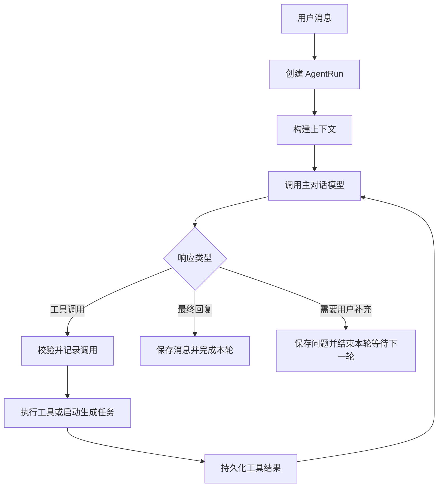

# VisionForge 技术方案提案

状态：架构讨论稿，作为后续实现依据，不代表相关能力已经实现。

更新日期：2026-11-18。

媒体专题调研与详细设计见 [图片、视频生成与媒体资产方案](MEDIA_PIPELINE_DESIGN.md)。其中媒体协议边界的调整为待采纳建议，不表示本提案的 Responses 约束已变更或相关能力已实现。

## 1. 产品定位与范围

VisionForge（幻影工坊）是以对话为主入口的图片与视频生成工作台。用户通过自然语言提出需求，主对话模型根据上下文选择工具，完成创意讨论、提示词优化、剧本编辑、素材选择、图片生成和视频生成。

首版通过第三方接入 OpenAI Responses API 调用模型。系统支持多个注册用户，但用户之间完全独立：没有工作空间实体，没有成员关系，也没有跨用户共享。一次会话自带一个工作区——这次对话里创建和引用的脚本、分镜、提示词、图片和视频都属于它。多人协作、审核、自建模型和复杂作品编排不在首版范围。

核心目标：

- 主模型动态决定是否调用工具、调用顺序以及如何使用结果。
- 模型调用、工具执行和长时间生成任务能够追踪、恢复和核对费用。
- 保存完整用户消息，同时独立管理模型上下文和摘要。
- 将生成图片、视频及其来源关系长期保存为可复用资产。
- 支持用户修改、重新生成和复用已有作品，保留版本与执行记录。

首版不建设独立微服务体系，不引入 Kafka 或 CDC，不自建 GPU 推理平台，不预先实现完整多镜头剪辑系统。

## 2. 已确定的设计方向

| 项目 | 设计方向 |
| --- | --- |
| 主交互 | 对话式工作台，主模型负责动态规划和工具选择 |
| 创作能力 | 图片、视频、剧本、素材操作均作为工具暴露 |
| 创作存储 | 脚本、分镜、提示词、图片和视频保存在所属会话的工作区；文件归属会话，不跨会话共享 |
| 工作流 | Agent Loop，不预设必须先写剧本、再生成图片、最后生成视频 |
| 模型接入 | 第三方接入 OpenAI Responses API（`POST /responses`）；必须使用 OpenAI 官方 Java SDK 的 Responses 客户端（`responses().createStreaming()`）。禁止自行拼装 `/responses` HTTP 请求、手写 SSE 事件解析或自己实现上游重试 |
| 上游协议 | 请求上游时使用 HTTP SSE（`stream: true`）；不使用 Chat Completions、同步响应或 WebSocket；不使用 `previous_response_id` |
| 协议假设 | 按讨论约定，假设上游实现 OpenAI Responses API 的 HTTP SSE 事件和工具调用语义，不将上游实现差异作为本提案的前置问题 |
| 上下文压缩 | 不使用 Responses compact 接口；compact 是一次普通的 Responses API 模型调用，摘要由本地管理和持久化 |
| 持久化执行 | 优先采用 Temporal，实施前通过故障恢复验证 |
| 消息中间件 | 首版移除 Kafka、Debezium/CDC，也不引入替代 MQ |
| 流式输出 | 上游 Responses API 使用 HTTP SSE；Worker 通过 Redis pub/sub 发布增量，API 再以 HTTP SSE 推送给前端；持久化消息是事实来源，断线不重放 |
| 业务存储 | PostgreSQL |
| 临时数据 | Redis，用于缓存、限流和 SSE 增量分发 |
| 媒体存储 | RustFS 或其他经过验证的 S3 兼容对象存储 |
| 数据库演进 | Flyway 管理业务数据库迁移 |
| 身份与隔离 | 多用户各自独立；无工作空间、无成员关系；access token 只绑定用户，数据按会话归属用户隔离 |
| 平台管理 | 系统 ADMIN 仅用于模型配置和用户管理等运维接口，不提供跨用户内容访问 |
| 后端布局 | Maven 模块保留在仓库根目录 |
| 部署布局 | Dockerfile、Compose 和部署环境模板保留在仓库根目录 |
| 前端 | frontend/ 中的 Next.js、TypeScript、Tailwind CSS 工程 |
| 许可方向 | 项目自有代码采用 Apache-2.0，第三方部分遵循其原始许可 |

模型角色暂按以下方式规划，实际模型 ID 通过配置映射：

- gpt-6-astra 等文本模型：主对话、创意与提示词完善、剧本创作、摘要生成。
- image-2、Seedream：图片生成或编辑能力。
- Seedance：视频生成能力。

上述名称表示产品接入目标，不作为对官方模型命名和能力范围的断言。参数和能力由模型目录配置。统一接入方式与 SDK 不意味着内部业务必须使用同一种生成操作；视频任务仍然需要明确的提交、查询、取消和产物获取语义。

## 3. Maven 模块调整

建议由原来的十个模块收敛为八个模块。API 与 Worker 是两个启动入口，其余为共享业务或资源模块。

| 模块 | 处理方式 | 职责 |
| --- | --- | --- |
| common | 保留 | 少量跨模块基础类型和错误定义，避免成为通用代码堆积区 |
| identity | 保留 | 用户与登录；不含工作空间和成员 |
| asset | 保留 | 会话工作区文件、上传下载、对象存储、媒体元数据、文件版本、资产引用及生命周期 |
| billing | 保留 | 模型用量、费用、额度预占、结算和流水 |
| agent | 调整后的核心业务模块 | 会话、上下文、动态工具调用、生成任务；通过 asset 读写当前会话的工作区 |
| api | 保留 | HTTP/SSE 入口、请求校验、认证接入和服务启动装配 |
| worker | 保留 | Temporal Worker 启动、Workflow/Activity 注册和执行资源配置 |
| database | 保留 | 业务数据库迁移脚本 |

原模块处理：

- bootstrap：删除独立模块，HTTP 服务启动职责归入 api。
- model：SDK 接入、模型能力和供应商适配合并到 agent 内部。
- generation：其任务和执行职责整合到 agent；生成任务的独立数据模型与生命周期继续保留。

目标布局：

```text
VisionForge/
├── pom.xml
├── common/
├── identity/
├── asset/
├── billing/
├── agent/
├── api/
├── worker/
├── database/
├── frontend/
├── docs/
├── Dockerfile
├── docker-compose.yaml
├── .dockerignore
└── .env.example
```

依赖约束：

- api、worker 负责装配业务模块，不能互相依赖。
- api 调用 agent 的公开应用服务，worker 注册 agent 提供的执行实现。
- agent 通过公开服务接口调用 identity、asset、billing。
- agent 通过 asset 的公开服务读写会话工作区；剧本和媒体不保存两份副本。
- identity、asset、billing 不反向依赖 agent，归属关联可以保存业务 ID。
- common 不依赖业务模块，不放 Web 启动配置或持久化实体。
- database 不依赖业务模块，迁移发布也不依赖 API 或 Worker 的启动。
- 跨模块不直接访问对方的 Mapper、Repository 或数据库实体。

agent 内部先采用包级划分，具体包结构可随实现调整：

```text
agent/
├── conversation/    # 会话、消息、分支
├── context/         # 上下文构建、快照和摘要
├── runtime/         # AgentRun、模型步骤、工具执行记录
├── tool/            # 工具定义、校验和分发
├── creative/        # 剧本、分镜、提示词工具；读写会话工作区，不维护独立文件副本
├── generation/      # 图片、视频生成任务
├── provider/        # SDK、模型能力、路由和上游调用
└── temporal/        # Workflow、Activity 及其实现
```

这些是职责边界，不要求每个包立刻建立完整分层。需要复用或独立演进时再拆 Maven 模块。

## 4. 核心业务对象

必须区分对话、单轮执行、创作作品和媒体生成任务：

| 对象 | 含义 |
| --- | --- |
| Conversation | 用户会话，生命周期可以长期持续 |
| Message | 用户或系统实际呈现的消息，支持多个内容块 |
| AgentRun | 一次用户请求或一次明确续跑的执行过程 |
| ModelInvocation | 一次实际模型调用及其参数、结果和用量 |
| ToolInvocation | 一个工具调用及其参数、执行状态和结果 |
| ConversationFile | 会话工作区中的脚本、提示词、分镜、图片或视频文件 |
| ConversationFileVersion | 文件内容的不可变版本，包含文本内容或媒体资产引用 |
| GenerationTask | 一次图片或视频生成请求，有独立执行和结算状态 |
| GenerationAttempt | 某个生成任务的一次上游执行尝试 |
| Asset | 已上传或生成的图片、视频及衍生文件 |
| ContextSnapshot | 某次模型调用使用的上下文组成与版本 |

一个会话可以包含多次 AgentRun，一个 AgentRun 可以调用多个工具，一个工具也可以创建独立的长时间生成任务。AgentRun 结束不意味着生成任务必须结束。会话工作区里的文件属于该会话，不跨会话共享；会话删除时文件按保留策略一起处理。

## 5. 身份与数据隔离

系统支持多个注册用户，但用户之间完全独立：没有工作空间实体，没有成员关系，也没有跨用户共享。一次会话就是数据归属的边界，会话里的文件构成该会话的工作区。

### 5.1 用户与隔离边界

- 用户注册即可使用，登录后直接进入自己的会话列表，没有空间选择或切换。
- 不存在 workspace、workspace_member 表，也不存在 OWNER/ADMIN/MEMBER 空间角色。
- 会话通过 `created_by` 归属用户；会话工作区里的文件通过 `conversation_id` 归属会话，从而归属用户。
- 所有业务查询必须同时带 `user_id` 条件，`user_id` 只能来自 access token 或服务端执行上下文，不能来自请求体、模型参数或工具参数。
- 访问不属于当前用户的会话、文件或生成任务时统一返回 404，不泄露资源是否存在。
- 数据不跨用户、不跨会话共享；另一个会话需要同一份内容时，复制或重新生成。

### 5.2 角色

| 层级 | 取值 | 作用 |
| --- | --- | --- |
| 系统角色 | ADMIN / USER | 仅用于模型配置、用户管理等运维接口 |

- 没有工作空间，也就没有“平台管理员进入任意空间”这一语义；ADMIN 不提供跨用户内容访问能力。
- 业务接口只校验资源归属，不校验角色；运维接口放在 `/api/v1/admin/**`。

### 5.3 登录与鉴权

- access token claims 包含 `sub`、`email`、`role`、`iss`、`aud`、`iat`、`exp`、`jti`；不再包含 `wsid` 和 `ws_role`。
- refresh token 是用户级凭证，刷新时只校验用户状态，不涉及空间成员关系。
- 登录直接签发 TokenPair，没有 selection token、空间选择和切换流程。
- 前端不存在 `/w/{workspaceId}` 路径段，也不在本地记忆“当前空间”。

隔离规则：

> 所有业务查询都必须限定当前用户；资源不属于当前用户时返回 404，而不是 403，避免泄露资源存在性。

### 5.4 接口草案

```text
POST /api/v1/auth/register
POST /api/v1/auth/login
POST /api/v1/auth/refresh
POST /api/v1/auth/logout
GET  /api/v1/me

GET    /api/v1/conversations
POST   /api/v1/conversations
GET    /api/v1/conversations/{conversationId}
DELETE /api/v1/conversations/{conversationId}
```

运维接口保留在 `/api/v1/admin/**`（模型配置、用户管理），仅系统角色 ADMIN 可访问。

错误码至少包括：用户不存在、凭证无效、会话不存在、文件不存在、版本冲突。

### 5.5 数据模型

- user_account、refresh_token、audit_log 保持用户级；audit_log 记录 `user_id`，不记录 workspace_id。
- 删除 workspace、workspace_member。
- conversation 保留 `created_by` 作为归属依据，删除 `workspace_id`。
- 不建立成员、邀请或空间相关表。

### 5.6 审计与执行上下文

- `@BizLog` 记录操作者 user_id、操作类型和 traceId，不存在空间维度。
- 用户尝试访问他人会话或文件时记录安全审计。
- agent、asset、billing 的公开服务接口显式接收 userId，由 API 层从 token 注入。
- Temporal Workflow 的启动参数携带 userId 和 conversationId；Activity 不信任模型输出中的用户或会话标识。
- 工具执行上下文只包含 userId、conversationId、agentRunId 和 toolCallId。

### 5.7 实施顺序

1. V11：删除 workspace_member、workspace；conversation 改为仅按 `created_by` 归属。
2. V12：把 workspace_item / workspace_item_version / conversation_item 迁移为会话级文件表和版本表。
3. identity：删除 workspace 包，移除空间选择与切换接口，Token 去掉空间 claims。
4. api：路径去掉 `{workspaceId}`，会话列表按当前用户过滤。
5. 端到端验证：跨用户访问返回 404、会话隔离、文件随会话归属。

### 5.8 会话工作区的边界

- 会话拥有它的文件；删除会话时按保留策略处理这些文件，不再存在“删除绑定但保留条目”的语义。
- 不存在跨会话引用；生成任务固定文件版本，而不是跨会话共享的条目版本。
- 后续如果引入分享或协作，需要单独设计共享模型，不能把“当前用户可见”直接扩大成“其他人可见”。

## 6. 动态 Agent Loop

主 Workflow 只约束可靠执行规则，不写死业务步骤。



示例路径：

- 创意讨论：直接回复，不生成媒体。
- 已有提示词：直接调用图片或视频工具。
- 修改剧本：读取会话内文件的指定版本，修改部分内容并保存新版本。
- 图生视频：选择已有素材，直接提交视频任务。
- 完整短片：模型根据需求选择会话内文件、参考图、分镜和生成工具。

工具操作的对象是当前会话工作区里的文件。文件属于会话，不跨会话共享；生成任务固定文件版本。

是否继续调用工具由模型输出和执行状态共同决定，不能仅以“本次没有工具调用”判断所有响应均已正常结束。响应不完整、调用超时和用户取消需要独立处理。

模型调用统一走 Responses API。每次调用由 Activity 显式构造完整 `input`：系统指令、历史消息、之前的 `function_call` 和 `function_call_output` 都在本次请求中重新提交。请求使用 HTTP SSE，读取 `response.output_text.delta`、`response.function_call_arguments.*`、`response.completed` 等事件；不使用同步响应、WebSocket 或 `previous_response_id`。助手文本来自 message 输出项，工具调用来自 function_call 输出项，工具结果以 function_call_output 回填后进入下一轮。

每轮记录提示词版本、工具定义版本、模型配置、上下文快照及调用结果。对于同一个会话分支，首版默认串行推进 AgentRun，避免并发回复覆盖状态；不同分支和不同会话可以独立执行。

前端可以增加图片、视频快捷入口，但它们应复用相同业务服务与任务语义，不另建一套生成规则。

## 7. 工具设计

工具是模型使用业务能力的接口，业务规则仍由服务端执行。

| 工具示例 | 职责 |
| --- | --- |
| list_files | 列出当前会话工作区中的文件 |
| search_files | 按标题、类型或路径查询当前会话工作区 |
| read_file | 读取文件元数据、文本内容或指定版本；媒体返回资产信息 |
| create_file | 在当前会话工作区创建文件 |
| update_file | 基于 base_version 修改文件，产生新版本 |
| list_file_versions | 列出文件的版本历史 |
| search_assets | 查询当前用户可访问的素材 |
| inspect_asset | 获取媒体信息和可供模型使用的内容 |
| generate_image | 创建并执行图片生成任务 |
| generate_video | 创建并执行视频生成任务 |
| get_generation | 查询任务状态和产物 |
| cancel_generation | 请求取消生成任务 |

主模型可以直接生成剧本内容，通过 create_file 以 `kind = SCRIPT` 保存到当前会话工作区。`create_script`、`read_script`、`update_script` 可以作为基于文件的类型化封装，但底层必须复用同一套文件与版本模型，不能建立第二套事实来源。工具不必再次调用同一个文本模型。

每个工具定义应包含参数 Schema、返回结构、副作用类型、权限要求、幂等策略、预算要求、超时策略，以及是否支持后台执行。

执行约束：

- 工具参数不直接构成授权；会话和用户身份来自服务端执行上下文。
- 模型不能指定任意类名、SQL、代码或执行器；工具名映射到受控注册表。
- 文件路径必须在当前会话工作区根目录内，拒绝绝对路径和 `..`；文本大小、媒体类型和总存储量受限。
- 调用标识由 AgentRun、模型步骤和工具 call_id 等组成，重放同一调用不重复执行副作用。
- 重复的同一调用与用户明确要求“再生成一次”需要区分，后者创建新任务。
- 无数据依赖且无写入冲突的工具可以并行；同一文件修改必须携带 `base_version`，版本冲突作为结构化结果返回模型。
- 参数不合法、额度不足、权限不足等作为结构化结果处理，不进行无意义的基础设施重试。
- 技术异常先由执行层恢复；需要修改方案时，将可解释的失败交回模型。
- 限制调用轮数、总执行时间、并发数量和成本，避免无限循环。

工具返回必要的摘要、`file_id`、版本和 `asset_id`。完整剧本、媒体文件及大量结果保存在会话工作区或对象存储中，不放入模型上下文或 Temporal 历史。

## 8. Temporal 执行模型

优先采用 Temporal，Restate 等作为备选评估对象，不同时引入两套执行引擎。

### 8.1 Workflow 与 Activity 边界

- Workflow 管理执行顺序、分支、并行、持久化等待和取消传播。
- Activity 执行模型调用、数据库访问、文件传输和媒体处理等外部操作。
- 模型 Activity 通过官方 SDK 的 Responses 流式客户端读完整个 HTTP SSE 流，再把完整文本、工具调用、用量和 `response_id` 返回 Workflow；Workflow 和业务代码都不直接解析供应商事件。
- 模型决策通过 Activity 返回并被记录；Workflow 根据已记录结果推进动态分支。
- 重放使用已完成调用的记录，不重新询问模型已决定过的步骤。
- 不在 Workflow 代码中直接访问网络、数据库或非确定性的外部状态。
- 不将整个 Agent Loop 放进一个大 Activity，以便按模型步骤和工具执行恢复。
- SDK 不能直接渗透进业务接口，供应商对象在 provider 层转换。
- HTTP SSE 是传输协议，不是实现方式：由官方 SDK 负责建立流、解析 `response.*` 事件和累计结果；provider 只负责领域请求与 `Response` 的映射，业务代码不得手写 HTTP/SSE 解析。

### 8.2 流程划分

| Workflow | 职责 |
| --- | --- |
| AgentRunWorkflow | 一轮对话或明确续跑的动态模型与工具调用循环 |
| ImageGenerationWorkflow | 图片生成、结果归档与费用处理 |
| VideoGenerationWorkflow | 视频提交、等待结果、归档与费用处理 |
| ContextCompactionWorkflow | 对固定范围的消息生成摘要并发布新上下文版本 |

作品级或多镜头 Workflow 后续按真实需求增加，不作为所有请求的必经流程。

视频工具内部可以有稳定步骤：提交、保存远端任务 ID、等待回调或 Timer、查询、归档、提取元数据、结算。工具内部的可靠执行顺序不限制主 Agent 的动态规划。

供应商等待使用持久化 Timer 或外部事件推进，避免一个 Activity 持续阻塞整个视频生成时长。文件传输和媒体处理等长 Activity 按需设置心跳与执行超时。

### 8.3 同步等待与后台执行

| 情况 | 执行方式 |
| --- | --- |
| 后续步骤依赖生成产物 | Workflow 持久化等待完成，将结果交回主模型 |
| 当前只需要启动任务 | 返回 task_id 和已受理状态，后台继续执行 |

后台生成采用独立生命周期的 Workflow，或对 Child Workflow 明确设置父流程结束策略。不能让对话完成意外终止已付费的视频任务。

后台任务完成后更新资产、任务卡片和消息。需要模型继续解释或创作时，创建新的续跑 AgentRun；已经完成的 AgentRun 不再等待后续 Signal。

工具返回“已受理”与“已完成”采用不同状态，模型不能把受理结果描述成生成成功。

### 8.4 重试、结果不确定和取消

Temporal 提供执行恢复，不自动保证外部副作用恰好一次。重点处理以下窗口：供应商已接单，但应用尚未保存远端任务 ID 就退出。

- 优先使用稳定的上游幂等标识；支持查询时先核对再决定是否重提。
- 无法确定结果时进入待核对状态，保留人工处理入口，不盲目重复付费请求。
- Activity 已持久化结果但尚未确认完成时，重试可以读取既有结果。
- 为付费提交显式配置 SDK 重试，避免与 Temporal 重试策略叠加。
- 归档失败只重试归档，不重新生成媒体。
- 用户取消需要记录申请、远端取消结果以及结算状态；本地超时不代表供应商未产生成本。
- 新采样或重新生成创建新的任务或执行尝试，保留与原任务的关联。
- 发布 Workflow 代码时评估历史重放兼容性，使用受控版本演进策略。

Workflow 历史只保存必要的状态与引用。对于过长的执行历史，后续使用适当的历史轮换策略，不将整段永久会话绑定到一个无限增长的 Workflow。

## 9. 移除 Kafka 与 CDC 后的可靠启动

首版不使用 Kafka、Debezium/CDC、RabbitMQ 或 NATS。Temporal Task Queue 承担 Workflow 和 Activity 的任务分发；Redis 也不作为业务生成任务的唯一可靠队列。

数据库提交与启动 Temporal 之间仍存在一致性窗口，因此保留轻量启动请求记录：

```text
事务保存用户消息、AgentRun 和 workflow_start_request
    → 提交数据库事务
    → 立即尝试启动 Temporal Workflow
    → 记录启动结果
```

启动补偿规则：

- Workflow ID 由业务执行 ID 派生，重复请求核对既有执行与参数。
- 消费或调用成功之前不将启动请求标记为已完成。
- worker 中的补偿任务处理尚未确认启动的记录，失败后退避再试。
- 数据库唯一约束和长期执行记录防止超出 Temporal 历史保留期后意外重新启动已完成业务。
- 补偿器只补齐启动动作，不轮询生成状态，也不替代 Temporal 的任务重试。
- 不为启动补偿单独创建 messaging、outbox 或 scheduler Maven 模块。

未来若出现搜索索引、数仓同步、多系统订阅和历史事件重放需求，再评估独立事件系统。届时根据需求选择 Kafka、RabbitMQ 或 NATS JetStream，不预先维护未使用的消息基础设施。

## 10. 存储职责与事实来源

| 存储 | 职责 |
| --- | --- |
| PostgreSQL | 用户消息、业务对象、会话工作区文件元数据与文本版本、上下文索引、任务状态、资产元数据和账目 |
| RustFS / S3 | 媒体、衍生文件、大型不可变文本版本，以及确有需要外置的快照 |
| Temporal | 执行历史、步骤恢复和持久化等待 |
| Redis | 缓存、限流、短期流式数据与进度通知 |

业务查询以 PostgreSQL 为入口，执行恢复由 Temporal 管理。通过幂等 Activity 更新业务状态，提供异常对账机制；不能让数据库调度和 Temporal 各自推进同一段业务。

Redis 丢失不应导致完整消息、任务或额度账目丢失。媒体不以 Base64 长期存入 PostgreSQL、Redis 或 Temporal 历史。

## 11. 消息与协议记录

### 11.1 消息列表

建议建立 conversation、conversation_branch、message、message_part 等实体。

- conversation 通过 `created_by` 归属用户；不同用户之间互相不可见，不存在跨用户共享。
- message 保存作者、顺序、分支、执行标识、状态和时间。
- message_part 支持文本、图片引用、视频引用和任务卡片。
- 编辑历史消息或重新生成回复形成新版本或分支，不覆盖原始记录。
- 后台任务完成可以更新关联卡片，或新增结果消息；变更需要可追踪。
- 列表使用稳定游标分页，避免把整段历史一次加载到客户端或模型。

### 11.2 协议层记录

前端可见消息与模型协议记录分开。除最终文本外，还需保留用于后续调用的工具请求、工具结果、响应阶段及其他必要输出项。

记录调用模型、参数、`response_id`、`request_id`、用量、执行尝试和错误分类。供应商响应应脱敏，大块媒体内容归档后转换为资产引用。

`response_id` 只用于查询、关联和排错，不能成为会话唯一存储，也不能用来隐式引用前文。每次调用都从持久化的消息、工具调用和工具结果显式构造完整 `input`；不使用 `previous_response_id`。加密或不透明的推理项只在协议要求的范围内保存和传递，不将其当作可读取的用户消息。

#### Responses API 调用约定

- 请求：通过官方 SDK 的 `responses().createStreaming()` 发起，底层为 `POST {baseUrl}/responses`、`stream: true`、`Accept: text/event-stream`。业务代码不直接拼装该 HTTP 请求，也不直接解析 SSE 文本。
- 请求体包含 `model`、显式 `input`、`max_output_tokens`、可选的 `tools`、`tool_choice`、`reasoning.effort` 和 `include: ["reasoning.encrypted_content"]`。
- `input` 是输出项数组：普通消息使用 `{role, content}`；历史工具调用使用 `{type: "function_call", call_id, name, arguments}`；工具结果使用 `{type: "function_call_output", call_id, output}`；推理项使用 `{type: "reasoning", summary, encrypted_content}`。
- 工具定义使用 Responses 格式：`{type: "function", name, description, parameters}`。
- SDK 负责消费并映射 SSE 事件，provider 只读取 SDK 暴露的文本增量、推理增量、最终 `Response`、工具调用、用量和 `response_id`。相关事件至少包括 `response.output_text.delta`、`response.reasoning_text.delta`、`response.reasoning_summary_text.delta`、`response.output_item.added`、`response.output_item.done`、`response.function_call_arguments.delta`、`response.function_call_arguments.done`、`response.completed`、`response.failed` 和错误事件。
- `response.completed` 中的 `response.id` 记录为 `response_id`；后续请求仍然重新提交完整 `input`，绝不使用 `previous_response_id`。

#### 推理项

推理模型可能返回两类推理项，处理方式不同：

- 加密推理项：只带 `encrypted_content` 和 `summary`，内容对应用不可读。它是跨轮携带推理状态的唯一载体，必须在下一轮 `input` 中按原顺序回放；回放时省略服务端 `id`，保留 `encrypted_content`，并始终提交 `summary`（无摘要时提交空数组）。
- 明文推理项：带可读的 `content` 或 `summary`，没有 `encrypted_content`。只持久化留档，不回放；部分供应商在后续请求中回传明文推理会直接报错。

请求统一附加 `include: ["reasoning.encrypted_content"]`，保证加密推理项被返回。

每个模型定义带 `reasoning_replay` 策略：`ENCRYPTED`（默认，只回放加密推理项）、`ALL`、`NONE`，用于适配口径不同的供应商。

推理项绑定它被生成时的输入前缀，因此：不跨 AgentRun 回放；发生 compact 后，旧 epoch 产生的推理项作废。`agent_run_turn` 记录 `context_epoch` 和推理项原始内容，回放时按 turn 顺序、且只取当前 epoch 的记录。

### 11.3 流式输出

当前最小实现采用 HTTP SSE，入口为 `POST /api/v1/conversations/{conversationId}/messages/stream`，响应类型为 `text/event-stream`。非流式消息接口保留，供不支持 SSE 或 Redis 暂时不可用的客户端轮询。

上游模型调用同样只使用 Responses API 的 HTTP SSE（`stream: true`），不调用同步响应接口，也不使用 WebSocket。下游 API 到浏览器使用 SSE，Worker 到 API 通过 Redis pub/sub 解耦；即使客户端使用非流式消息接口轮询，Worker 对上游仍然使用 SSE。

事件格式：

```text
event: accepted          data: {"type":"accepted","runId":"..."}
event: reasoning         data: {"type":"reasoning","content":"..."}
event: reasoning_summary data: {"type":"reasoning_summary","content":"..."}
event: delta             data: {"type":"delta","content":"..."}
event: done              data: {"type":"done","assistantMessageId":"..."}
event: error             data: {"type":"error","message":"..."}
```

推理内容与正文一样实时推送给客户端：明文推理使用 `reasoning` 事件，加密推理的摘要部分使用 `reasoning_summary` 事件。两者在正文 `delta` 之前按上游顺序到达，同一轮内保持顺序，但不保证跨轮合并成完整文本。

执行链路：

1. API 保存用户消息、AgentRun 和 workflow_start_request，并订阅该 run 的 Redis 频道。
2. Worker 的模型 Activity 将上游增量发布到 `visionforge:agent-run:{runId}`。
3. API 将 Redis 事件转换为 SSE 事件转发给客户端；收到 `done` 或 `error` 后关闭订阅。
4. Worker 持久化完整助手消息；SSE 只负责实时投递，不是业务事实来源。

约束：

- Redis pub/sub 是尽力而为，不缓存、不重放；客户端断线或 API 重启后，应重新读取消息和 AgentRun 状态，不能依赖补发增量。
- 当前事件只有 runId，没有 attempt_id 和顺序号；同一 run 的增量通过单线程订阅和同步分发保持顺序。需要断线续传时，再增加事件序号、短期缓存和 attempt_id。
- SSE 超时默认 5 分钟，可配置；超时只关闭推送，不取消 AgentRun 或已授权的生成任务。
- 浏览器不能使用 `EventSource` 携带 `Authorization` 头，应使用 `fetch` 流式读取。
- 工具进度、任务卡片和生成状态复用同一 SSE 通道扩展；当前实现推送推理增量（`reasoning`、`reasoning_summary`）和模型文本增量（`delta`）。
- 完整消息、工具调用和任务状态落 PostgreSQL；不逐 token 写业务表。
- 新尝试不能直接拼接到旧文本尾部；失败重试由新的 AgentRun 或明确的续跑产生。

## 12. 上下文构建与本地 compact

### 12.1 上下文组成

```text
本轮模型输入
  = 当前系统指令与工具定义
  + 用户确认的项目事实、会话内文件版本和选定素材
  + 当前历史摘要
  + 最近完整消息及对应工具记录
  + 当前用户请求
```

完整消息回答“实际发生过什么”，模型上下文回答“这次调用需要什么”。二者不共用一个会被 compact 覆盖的内容字段。

角色设定、风格要求、文件版本、预算和用户确认结果独立保存，不依赖摘要重新推断。上下文只引用会话内文件 ID 和版本，不复制文件内容。资产标识必须在调用前解析为上游实际可使用的输入内容或访问方式。

每次调用生成不可变 context_snapshot，记录会话分支、消息范围、摘要版本、文件版本、资产版本、系统指令和工具定义版本。可追溯并不意味着再次运行模型会产生相同输出。

### 12.2 摘要生成流程

不使用 Responses compact 接口。compact 是一次普通的 Responses API 调用（HTTP SSE），由应用生成并持久化结构化摘要：

1. 计算输入预算，包括文本、媒体和工具定义，并预留输出及后续工具调用空间。
2. 在接近预算前触发摘要；初始阈值可以从可用预算的 70%～80% 试验，后续依据实际效果调整。
3. 固定需要压缩的消息区间，避免截断未完成的工具调用和结果对。
4. 从该区间生成摘要，保留用户目标、约束、确认决定、否定方案、待解决问题和来源标识。
5. 将关键约束与结构化业务记录核对，记录摘要模型、参数和提示词版本。
6. 通过版本校验发布新的上下文版本；摘要期间到达的新消息仍保留在摘要范围之后。
7. 保存原始消息和协议记录，compact 不负责删除历史。

#### 触发与区间

- 每轮构建 `input` 前估算总量：系统指令、已有摘要、未压缩历史、当前 run 的 turns、工具定义和预留输出。超过预算的 80% 触发压缩，阈值可配置。
- 压缩区间从最早未压缩消息开始，到“尾部保留边界”之前结束；尾部保留量按预算倒推（约占 25%），不按固定条数。
- 切点只落在消息边界，不切开单条消息；当前用户消息和当前 run 的 turns 永不进入压缩区间。
- 摘要区间内不得出现半对工具调用：历史 `function_call` / `function_call_output` 只存在于 run 协议记录中，压缩仅覆盖 `message`，因此不会切断调用对。

#### 摘要调用

- 复用当前会话模型的 baseUrl、apiKey 和 model；不带 `tools`，`max_output_tokens` 单独配置，reasoning effort 使用 `NONE` 或 `LOW`。
- 走同一条 Responses 流式客户端，但增量不推送给客户端；调用结果以 `model_invocation.purpose = COMPACT` 记录，便于计费和排查。
- 摘要按固定结构输出：目标、约束、已确认、已否决、待解决、涉及的会话内文件 ID 与版本。
- 摘要文本本身设长度上限，超出要求重写，避免摘要反而撑爆预算。

#### 数据模型

```text
context_summary (
  id                  uuid,
  user_id             uuid,
  conversation_id     uuid,
  epoch               int,      -- 每次新摘要递增
  from_seq            bigint,   -- 覆盖的第一条 message.sequence_no
  to_seq              bigint,   -- 覆盖的最后一条
  content             text,     -- 结构化摘要
  source_digest       text,     -- 覆盖区间内容校验值
  model_definition_id uuid,
  prompt_version      text,
  input_tokens        int,
  output_tokens       int,
  created_at          timestamptz,
  unique (conversation_id, epoch)
)
```

#### 发布与失效

- 发布前校验覆盖区间未发生变化；不一致则丢弃本次结果。
- 写入时 `epoch = 该会话当前最大 epoch + 1`，`unique(conversation_id, epoch)` 兜底并发。
- 读取时校验 `source_digest`；不匹配视为过期摘要，忽略并重新压缩。
- 摘要调用失败或结果为空时，回退到截断历史，不失败 AgentRun；连续失败需要计数，避免每轮重复付费。
- 摘要不得把未经用户确认的模型建议提升为已确认事实。

### 12.3 压缩后的上下文边界

文本摘要是有损信息压缩，不使用 Responses compact 接口。

- 建立新的 context_epoch，从摘要和保留的消息重新构造输入。
- 完全不使用 `previous_response_id`；每次调用都显式提交摘要、保留消息和当前请求，避免重复上下文或版本混用。
- 不复用依赖旧前缀的加密推理项：`agent_run_turn.context_epoch` 与当前 epoch 不一致的推理项不再回放；旧协议记录继续用于排错。
- 新 epoch 内尽量追加新记录，减少无必要的前缀重写。
- 摘要以带来源的历史资料加入上下文，不作为新的系统权限或预算指令。
- 避免无限执行“摘要的摘要”；需要时从原始记录重建，并始终保留独立的项目事实。

### 12.4 当前 run 内的上下文增长

第一阶段 compact 只覆盖已持久化的对话历史。当前 run 自身的 turns（工具参数和工具结果）不在压缩范围内，超出预算时该轮模型调用失败并结束 run。

后续扩展沿用同一套摘要机制，覆盖 run 内已完成的 turn 区间：

- 只在 turn 边界切分，`function_call` 与其 `function_call_output` 必须成对保留或成对丢弃。
- 摘要替换被覆盖的 turn 后 `context_epoch` 递增，旧 epoch 的推理项一律不再回放。
- 当前 turn 和最近若干 turn 始终保留。

首版先使用明确引用和数据库查询找回历史事实，不默认引入向量数据库。出现跨大量历史内容的语义检索需求后再评估。

## 13. 会话工作区与媒体资产

### 13.1 会话工作区

每个会话拥有自己的工作区，保存这次对话产生的脚本、分镜、提示词、图片、视频和衍生文件。

- 文件归属会话，不归属用户级共享库，也不跨会话引用。
- 文件使用不可变版本；更新产生新版本，当前版本由 `current_version` 指向。
- 生成任务和快照固定版本号，后续修改文件不改变已提交任务。
- 版本记录 `source`、`created_by` 和 `tool_invocation_id`，用于追溯来源。
- 文本内容保存在版本表；图片、视频等二进制通过 `asset_id` 或对象存储键引用，不把 Base64 存入业务表、Redis 或 Temporal 历史。

建议实体：

```text
conversation_file：id、conversation_id、user_id、kind、title、path、mime_type、
                   storage_kind、current_version、status、
                   created_at、updated_at、deleted_at
conversation_file_version：id、file_id、version、content、asset_id、object_key、
                           size_bytes、checksum、source、created_by、
                           tool_invocation_id、created_at
```

`kind` 至少包括 SCRIPT、STORYBOARD、PROMPT、IMAGE、VIDEO、OTHER。约束至少包括 `UNIQUE (conversation_id, path)`（未删除文件）和 `UNIQUE (file_id, version)`。

接口草案：

```text
GET    /api/v1/conversations/{conversationId}/files
POST   /api/v1/conversations/{conversationId}/files
GET    /api/v1/conversations/{conversationId}/files/{fileId}
PATCH  /api/v1/conversations/{conversationId}/files/{fileId}
GET    /api/v1/conversations/{conversationId}/files/{fileId}/versions
```

所有接口先校验会话属于当前用户；不属于则返回 404。

### 13.2 剧本、提示词和分镜

剧本、提示词和分镜不再单独建立一套文件存储，作为会话内文件的类型表达：

- 剧本可以是 Markdown 或结构化 JSON；具体格式由工具和前端决定，不改变文件和版本模型。
- 每个版本记录来源消息、父版本、创建者和工具调用标识。
- 生成任务保存提交时冻结的文件版本、实际提示词、参数、引用素材、价格规则和授权预算；后续修改文件不改变已提交任务。
- 用户原始输入、优化后内容和实际提交参数都要保存。
- `create_script`、`read_script`、`update_script` 可以作为类型化工具封装，但底层必须复用 `conversation_file` / `conversation_file_version`。

### 13.3 媒体资产与对象存储

`asset` 负责二进制载荷和媒体元数据，`conversation_file` 负责会话内文件：

- asset 记录 user_id、所属会话、存储后端、bucket、object_key、类型、大小、校验信息、宽高、时长、来源任务和状态。
- 原始素材、生成结果、缩略图和封面分别保存为资产或明确的资产变体。
- 每次新生成创建新资产，不覆盖旧结果。
- 文件版本引用 `asset_id`，消息、剧本和生成任务引用文件版本或资产 ID，不把临时访问 URL 当作永久标识。
- 对象键由后端分配，文件名和存储路径不由模型或客户端直接控制。

### 13.4 上传、写入与结果归档

用户上传：创建上传会话、签发授权、客户端直传、服务端验证对象、创建 `conversation_file` 并写入初始版本；二进制文件同时创建 `asset`。

Agent 写入：`create_file` 在当前会话工作区创建文件并写入版本；`update_file` 基于 `base_version` 创建新版本，不原地覆盖。

生成结果归档：创建待归档记录、获取供应商结果、写入对象存储、校验元数据、将资产标为 READY、创建或更新文件版本，再完成交付与结算。

对象存储写入与数据库提交不是同一个事务，需要恢复机制：

- 已写文件但数据库未确认：根据稳定资产标识和校验信息完成确认或清理。
- 已有记录但对象缺失：标记异常并进入修复。
- 同一归档尝试重试：识别已保存对象；新的生成尝试使用新的资产标识。
- 供应商临时产物尽快归档，不作为唯一长期副本。

### 13.5 访问、可见性与生命周期

- 文件按会话隔离；所有查询必须带 `conversation_id`，该值来自服务端执行上下文，并校验会话属于当前用户。
- 不存在条目级可见性开关：文件只对所属用户可见，没有“私有/共享”两种状态。
- 私有对象通过业务鉴权和短期授权访问；提供给供应商的素材必须可从其网络访问，授权有效期覆盖实际读取时间。
- 下载上游产物时限制来源、重定向、响应大小和处理时间，防止归档过程访问内部网络。
- 图片、视频格式和大小需要真实验证；媒体处理放入受控执行环境。
- 删除会话时按保留策略处理其文件与资产；删除前检查活跃生成任务引用。
- 临时上传、孤儿对象和未完成分片有明确清理规则；正式资产按产品保留策略处理。
- 活跃 Workflow 引用的文件版本、资产和上下文快照不能被提前清理。
- 对象存储生命周期能力、预签名上传、分片和视频 Range 访问需要在目标 RustFS 版本验证。

### 13.6 后续共享与协作

首版没有共享模型。如果后续需要跨会话复用素材或多人协作，需要单独设计：

- 跨会话复用要么复制文件，要么引入显式的“引用”关系，不能默认共享。
- 多人协作需要重新定义归属和授权边界，不能把“当前用户可见”直接扩大成“其他人可见”。
- 审核、评论、任务分配和通知在出现明确需求后再设计。

## 14. 额度与成本

billing 独立于 Agent 的自然语言判断。

- 额度归属用户；多个用户各自独立计费，不存在空间级额度池。
- 普通对话、摘要和媒体生成分别记录用量及供应商成本。
- 创建 AgentRun 时不提前按一次图片或视频任务预占费用。
- 执行付费工具前，根据实际模型、参数和用户授权预占额度。
- 持续记录 AgentRun 总预算和已使用金额，模型无法自行提高预算。
- 预占、扣费、释放和流水在数据库事务中完成，并使用唯一业务标识防重。
- 金额使用定点小数，额度使用明确的最小计量单位。
- 保存执行时的价格版本，后续调价不改变历史账目。
- 用户计费与供应商成本分别记录，允许表达“产生上游成本但最终交付失败”。

取消、超时和部分成功的收费规则需要在实现前明确。不能把网络超时或本地流程退出直接解释为无成本并立即释放全部额度。

## 15. 数据库迁移与候选实体

业务迁移脚本集中放在 database/src/main/resources/db/migration，采用统一版本序列。发布时由独立 migration Job 执行 Flyway，成功后部署 API 与 Worker。

- 已发布的版本化脚本不修改，结构修正通过新迁移完成。
- 避免同时使用其他自动建表机制维护结构。
- 发布变更尽量兼容旧应用，大规模数据回填独立执行。
- Temporal 自身表结构与业务迁移分开管理，采用其适用的升级流程。

候选实体如下，具体表名与拆分数量在详细设计阶段确定：

| 领域 | 候选实体 |
| --- | --- |
| 身份 | user_account、refresh_token、audit_log |
| 会话 | conversation、conversation_branch、message、message_part |
| 会话工作区 | conversation_file、conversation_file_version |
| Agent | agent_run、model_invocation、tool_invocation、workflow_start_request |
| 上下文 | context_snapshot、context_summary |
| 创作 | 剧本、分镜和提示词由 conversation_file 的 kind 表达，不单列 creative_document |
| 生成 | generation_task、generation_attempt、generation_output |
| 模型配置 | model_definition、provider_config、model_price_rule |
| 资产 | asset、asset_variant、asset_reference、upload_session |
| 费用 | credit_account、credit_reservation、credit_ledger、usage_record |
| 审计 | audit_log |

高频查询字段采用明确列，供应商扩展参数和脱敏快照可使用 JSONB。用户隔离、幂等和结算约束必须落实到服务端查询与数据库约束。`conversation_file` 是会话内文件，`asset` 是二进制载荷。

## 16. 部署、观测与许可

首版按 API、Worker、前端三个应用角色部署，使用 PostgreSQL、Redis、RustFS 和 Temporal。Temporal 的持久化与业务库逻辑隔离，资源规模根据压测确定。

配置及密钥由部署环境提供，日志脱敏。日志、指标和执行记录通过 conversation_id、agent_run_id、tool_invocation_id、generation_task_id 与 Workflow ID 关联。

重点观察模型调用成功率、工具失败分类、生成等待时间、待核对请求、结果归档失败、未结算任务、启动补偿积压、费用和存储增长。内测前完成数据库与对象存储的备份恢复验证。

前端保持 Next.js、TypeScript、Tailwind CSS，后续按需接入 shadcn/ui 和动画组件。项目自有代码沿用 Apache-2.0；第三方组件保留来源和许可，不能因为根目录存在 Apache-2.0 就统一变更其授权。

讨论中发现 Animate UI 的许可包含附加条件。引入具体版本时核对实际许可，不按纯 MIT 假设处理；这项选型尚未通过当前前端骨架落地。

## 17. 开发阶段与验收

| 阶段 | 主要交付 | 验收重点 |
| --- | --- | --- |
| 1. 基础工程 | 八模块边界、数据库迁移、身份与用户隔离、Temporal 基础环境 | API/Worker 可启动，迁移可从空库执行 |
| 2. 对话与工具循环 | 消息持久化、上下文快照、Responses API HTTP SSE 调用、会话工作区、文件与剧本工具、动态分发 | 模型能直接回复或多轮调用工具；上游只使用 Responses API SSE；进程恢复不重复创建文件版本 |
| 3. 图片闭环 | 素材上传、图片工具、费用预占、生成与归档 | 重复请求不重复扣费，产物可以查看和下载 |
| 4. 上下文压缩 | 摘要、上下文版本、来源追溯和预算控制 | 压缩不丢失关键确认信息，不删除历史消息 |
| 5. 视频闭环 | 视频工具、长任务等待、取消、封面和后台完成通知 | AgentRun 结束后生成可继续，归档失败单独恢复 |
| 6. 内测准备 | 运营排查、故障演练、成本对账、压测与备份恢复 | 达到约定负载和恢复目标 |

实施前或实施过程中必须覆盖的故障场景：

1. 保存用户请求后、启动 Workflow 前退出，补偿能够恢复启动。
2. 同一个启动请求重复执行，最终只有一次有效业务执行。
3. 供应商接单后、本地保存远端 ID 前退出，进入核对而非盲目重复提交。
4. Activity 完成业务写入后中断，重试不重复修改文件或扣费。
5. 视频回调重复、乱序或缺失，任务能够正确推进。
6. 供应商成功但对象存储暂时不可用，仅恢复归档步骤。
7. 多个任务竞争有限额度，不出现超额消费。
8. Redis 重启后，消息、任务与账目仍可恢复查询。
9. 摘要期间收到新消息，新消息不会丢失或被错误纳入旧摘要。
10. 浏览器断线、AgentRun 结束或用户取消时，后台任务与费用状态符合明确规则。
11. Workflow 代码升级后，已有执行仍可恢复。
12. 用户尝试访问其他用户的会话、任务和素材时返回 404。
13. 同一用户的多个会话之间文件互不可见，不存在跨会话引用。
14. 同一工具调用重放不重复创建 `conversation_file_version`。
15. 并发更新同一文件时，`base_version` 冲突被拒绝，不静默覆盖。
16. 删除会话后其工作区文件按保留策略处理，不残留可访问数据。

## 18. 当前实现差距与后续决策

截至 2026-11-18，仓库已落地八模块布局、根 POM 依赖与插件版本（Java 21、Spring Boot 4.1.2 BOM、Temporal Java SDK 1.41.1 BOM）、Maven Wrapper 3.9.16、API/Worker 最小启动入口和 Temporal 自检 Workflow。Flyway 迁移已到 V12：identity 表为 user_account、refresh_token、audit_log，会话工作区为 conversation_file、conversation_file_version，workspace 和 workspace_member 已在 V11 删除；Compose 提供 PostgreSQL 和 Redis。

已实现：

- common：统一响应、错误码、UUIDv7、自研 `@BizLog`。
- identity：bcrypt 密码、JWT access/refresh、RBAC（ADMIN/USER，仅用于运维接口）、直接登录签发 TokenPair、refresh 轮换。工作空间、成员、空间选择和切换已全部移除；access token 不再包含空间 claims。
- agent：模型配置（baseUrl、加密 apiKey、模型 ID、reasoning effort、最大输入/输出）、conversation/message/agent_run/model_invocation/agent_run_turn 落库；模型调用通过 OpenAI 官方 Java SDK 的 `responses().createStreaming()` 请求 Responses API，显式构造 `input`，不使用 Chat Completions、同步上游或 `previous_response_id`。`AgentRunWorkflow` 已实现多步工具循环：模型 Activity 返回工具调用，Workflow 逐个调用工具 Activity，再以 `function_call_output` 回填进入下一轮；循环不设轮数上限，唯一的规模约束是当前对话上下文 token 预算；每轮模型输出写入 `agent_run_turn`，重放时不再重复请求模型。Worker 运行时并发/缓存/优雅停机和启动补偿已实现。
- asset：会话工作区文件已实现，提供创建、读取、更新、搜索、版本列表和指定版本读取；更新使用 `baseVersion` 检测并发冲突，单条文本上限 1 MB，所有查询按 `conversation_id` + `user_id` 限定。V12 迁移创建 `conversation_file` 和 `conversation_file_version`。
- agent 工具注册表：已实现 `ToolDefinition`、`AgentTool`、`ToolRegistry`、`AgentToolExecutor` 和 `tool_invocation` 幂等记录；注册 `list_files`、`search_files`、`read_file`、`create_file`、`update_file`、`list_file_versions` 六个会话工作区工具。工具参数只包含文件 ID、路径和内容，会话和用户来自服务端执行上下文。
- 流式：`POST /messages/stream` 已按 SSE 返回 accepted/delta/done/error；Worker 通过 Redis pub/sub 发布模型增量，助手消息以数据库为准；非流式接口保留。
- 会话串行：同一会话在任意时刻只允许一个 PENDING/RUNNING 的 AgentRun；消息序号分配在会话行锁内完成，存储层用部分唯一索引兜底，活跃期间再次发送返回 409。
- 本地 compact：接近输入预算时，用一次普通的 Responses 调用把最早的消息区间压成结构化摘要，写入 `context_summary` 并递增 epoch；摘要按覆盖区间校验 `source_digest` 判定是否过期，摘要调用以 `purpose=COMPACT` 记录。失败或摘要为空时回退到裁剪历史，不失败 AgentRun。
- 推理项：请求统一携带 `include: ["reasoning.encrypted_content"]`；每轮把推理项原文写入 `agent_run_turn.reasoning`，并记录 `context_epoch`。下一轮按 `model_definition.reasoning_replay` 回放：默认只回放带 `encrypted_content` 的推理项，且省略服务端 `id`、始终提交 `summary`；明文推理只留档不回放。`context_epoch` 与当前 epoch 不一致的推理项不再回放。明文推理增量和加密推理的摘要增量分别以 `reasoning`、`reasoning_summary` 事件实时推送给客户端。

尚未实现：

- 工具调用的 SSE 进度事件。
- run 内 turn 级压缩（第一阶段只压缩已持久化的对话历史）、真实媒体生成。
- Dockerfile 仍为占位；Compose 尚未纳入 Temporal 和 RustFS。

需要通过实现验证或产品决策确定的事项：

- 会话删除后工作区文件的保留策略：级联删除、软删除后定期清理，还是保留只读归档。
- 跨会话复用素材是否需要一个显式的“复制到当前会话”操作。
- 剧本采用 Markdown、结构化 JSON 或两者兼有。
- Temporal 的部署方式与资源策略；SDK 与 Spring Boot 的版本组合已在根 POM 确定。
- 工具后台执行、自动续跑、取消及部分成功的交互与计费语义。
- 模型的实际能力配置、费用规则和不同错误的恢复策略。
- 摘要质量标准、上下文预算、历史和媒体的保留规则。
- 第三方 UI 组件的具体版本与许可范围。

上游对 OpenAI Responses API 的实现程度按已约定前提处理。目标协议已确定为 OpenAI Responses API + HTTP SSE：不使用 Chat Completions、同步上游响应、WebSocket、`previous_response_id` 或 Responses compact；compact 始终是一次普通的模型调用。这里不使用“OpenAI 兼容网关”这一说法，因为它通常指 Chat Completions 兼容，而本项目目标是 Responses API。Kafka 和 CDC 不作为上述待办的前置依赖。不能将本提案当作实现完成说明。
